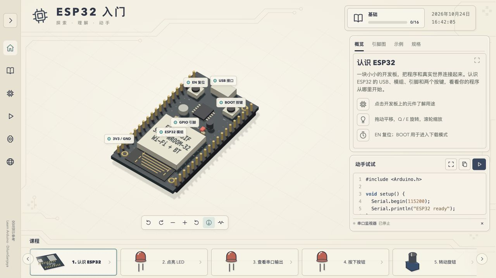

<p align="center">
  <a href="README.md">中文</a> · <a href="README.en.md">English</a>
</p>

# Learn ESP32 · 机器人 0→1 在线实验室

借助 ESP32，在浏览器里从 0 到 1 走完一台差速机器人：接线、写码、调参、闭环、联调。25 课，目标开发板为 **ESP32-DevKitC V4 / ESP32-WROOM-32E（38 针）**。

它不替代真机，替代的是真机之前那段最贵的试错：接错线、烧驱动、CPR 填错、PI 调反、忘了做指令超时。

[课程内容](docs/CURRICULUM.md) · [机器人主线](docs/ROBOTICS_COURSES.md) · [引脚预算](docs/PIN_MAP.md) · [语法入门（公众号）](https://mp.weixin.qq.com/s/fG325zBvtpMfLdrcj9bx6g) · [参与贡献](CONTRIBUTING.md) · [MIT 许可证](LICENSE)



## 定位

- **ESP32 是载体，机器人系统是目的。** 前 12 课补电平、PWM、ADC、I2C 与时序；13–16 课让机器人可被外部指挥；17–25 课把感知、执行、反馈、通信和安全停车连成整机。
- **0→1 指整机链路走通，不是「认识开发板」。** 结课时应能接收 `TWIST` 速度指令（m/s、rad/s）、回传实测、遇障停车、断链停车。
- **模拟换的是试错成本，不是硬件。** 每个现象有量纲、每个参数有出处、每段代码可导出 `.ino` 编译；接线与烧录仍需真机。
- **不追更多课，追更硬的验收。** 五段各自的验收与常见失败：

| 段 | 要能做到 | 常见失败 |
| --- | --- | --- |
| 认知 | 指出哪根线会烧板、哪个引脚只能输入 | 5 V 直连 GPIO、ADC2 与 Wi-Fi 冲突 |
| 接线 | 不看答案复现一课电路，说清为什么独立供电 | 缺共地、ECHO 未分压、电机从 3V3 取电 |
| 写码 | 解释每一行为什么这么写，改参数能预测结果 | 把 PWM 当转速指令、用 delay 做多任务 |
| 闭环 | 90 RPM 抗 30% 负载；直行 1 m 偏差 <5 cm | CPR 填错、编码器反向、PI 周期抖动 |
| 联调 | 指令 <100 ms；遇障停；断链 1 s 停；上电默认不动 | 无超时停车、无 fail-safe |

## 功能与边界

- 3D 开发板和器件：平移、旋转、缩放、拾取、检查器和聚焦。
- 参数、示例代码、原理图、场景和串口反馈联动。
- 四个课程页签、代码复制、模拟运行/停止、设置与本地学习进度。
- 旋钮调光、光控夜灯、迷你钢琴、智能植物，以及 Wi-Fi / HTTP / 网页控制的课堂演示。
- 机器人主线：测距、电机驱动、编码器、PI 调速、差速运动、UART、BLE、ESP-NOW 与综合小车；对外指令采用 ROS 2 的 Twist 语义（m/s、rad/s）。
- 中文课程；英文说明及 13 语种界面入口。其余 11 种语言的课程全文尚未翻译。

**这是参数化教学模型**，不执行任意 C++，不连接电脑的 Wi-Fi、蓝牙、串口或真实 ESP32，也不模拟面包板孔位的导通。真实硬件需要另外编译、烧录和接线。它是独立的社区学习项目。

## 快速开始

需要 **Node.js 24.x** 和随附的 npm。已提供 `.nvmrc`；使用 nvm 时可先执行 `nvm use`。

进入克隆后的仓库根目录：

```bash
npm ci
npm run dev
```

打开终端打印的 Local 地址。浏览器需支持 WebGL。无需账户、数据库、服务端 API 或环境变量。

| 命令 | 用途 |
| --- | --- |
| `npm test` | 核心行为测试 |
| `npm run build` | 类型检查与静态构建，输出 `dist/` |
| `npm run preview` | 本地预览构建产物 |
| `npm run build:standalone` | 构建并生成内嵌资源的 `output/learn-esp32.html` |
| `npm run check:dist` | 核对根路径/子目录资源、许可证和单文件脚本语法 |
| `npm run firmware:export` | 导出 25 课默认 `.ino`，另附 ESP-NOW 发送端（共 26 份） |
| `npm run firmware:check` | 使用已安装的 Arduino CLI 编译默认示例 |

`dist/`、`output/` 和依赖目录不提交 Git。静态构建会附带本项目与 Three.js 的完整许可声明；单文件 HTML 也保留这些声明。`file://` 模式尚未进行直接浏览器验收，推荐先通过 HTTP 预览。

## 部署到 GitHub

可以直接发布到 **GitHub Pages**，无需租用服务器。仓库已提供只读权限的 CI；推送到 `main` 分支会**自动触发** Pages 构建与发布，也可在 Actions 中手动触发。

1. 将本目录内容放在 GitHub 仓库根目录，包括 `.github/` 和锁文件。
2. 在仓库 **Settings → Pages → Build and deployment → Source** 中选择 **GitHub Actions**。
3. 推送（或合并 PR）到 `main`，或打开 **Actions → Deploy to GitHub Pages → Run workflow** 手动触发，选择默认分支。
4. 工作流成功后，通过 deployment 给出的地址访问站点。

资源使用相对路径，同一份 `dist/` 可用于用户主页和仓库子目录。Pages 中运行的是浏览器教学模型；真实设备固件不在 GitHub 服务器上运行。配置说明与发布检查见 [部署文档](docs/DEPLOYMENT.md)。

学习进度保存在访问者浏览器，不会跨设备同步。更换站点域名或端口也不会自动迁移进度。

## 课程

前 16 课是机器人的零件库：1–12 补电平、PWM、ADC、I2C 与时序，13–16 把控制权交给外部设备。17–25 是整机主线：感知、执行、反馈、通信、安全停车。分组只用于阅读，不构成解锁门槛。

接线分两段：第 1–16 课是面包板实验台，第 17–25 课按[固定引脚表](docs/PIN_MAP.md)装配机器人；两段之间有一次性迁移，冲突矩阵和迁移清单都在引脚预算表里。

| 课次 | 内容 |
| --- | --- |
| 01–04 | 认识 ESP32、闪灯、按钮、旋钮调光 |
| 05–08 | 混合颜色、光控夜灯、温度报警、OLED |
| 09–12 | 非阻塞控制、舵机、智能植物、迷你钢琴（选做） |
| 13–16 | Wi-Fi、网页读温度、网页控灯（选做）、联网植物监测（选做） |
| 17–20 | 超声波测距、电机驱动、编码器测速、PI 闭环调速 |
| 21–25 | 双轮差速、UART、BLE（选做）、ESP-NOW（选做）、综合双轮机器人 |

带「选做」标记的课程不在主线的依赖链上，可以跳读；第 23、24 课是同一套指令契约的两种无线载体，任选其一即可。

课程参数、引脚与四页签内容见 [课程定义](docs/CURRICULUM.md)。

## 编程入门文章

[《六个月学机器人⑦：Arduino / ESP32 语法入门，从零读懂并写出程序》](https://mp.weixin.qq.com/s/fG325zBvtpMfLdrcj9bx6g) 从变量、分支、循环、函数讲到数组、对象、回调、屏幕和联网，附 16 份课程示例快照与 3 个独立练习。正文在公众号发布。

封面、SVG/PNG 配图、绘图脚本及 16 份示例程序仍保留在 [独立教程目录](tutorials/arduino-esp32-syntax/README.md)。教程与正在更新的课程实现分别维护，对照课序、引脚和 API 时请核对 [示例版本](tutorials/arduino-esp32-syntax/VERSION.json)。

## 真机代码

基线为 Arduino-ESP32 **3.3.12**、FQBN **`esp32:esp32:esp32`**、串口 **115200 baud**。第 8、11、16 课依赖：

- Adafruit SSD1306 **2.5.17**
- Adafruit GFX Library **1.13.0**
- Adafruit BusIO **1.17.4**

安装 Arduino CLI 后，配置官方索引和固定依赖：

```bash
arduino-cli core update-index --additional-urls https://espressif.github.io/arduino-esp32/package_esp32_index.json
arduino-cli core install esp32:esp32@3.3.12 --additional-urls https://espressif.github.io/arduino-esp32/package_esp32_index.json
arduino-cli lib install "Adafruit SSD1306@2.5.17" "Adafruit GFX Library@1.13.0" "Adafruit BusIO@1.17.4"
npm run firmware:check
```

自定义 CLI 路径或配置文件：

```bash
npm run firmware:check -- /path/to/arduino-cli /path/to/config.yaml
```

示例源文件输出到 `output/sketches/<课程 ID>/<课程 ID>.ino`；第 24 课默认导出小车接收端，额外的遥控发送端位于 `output/sketches/espnow-sender/espnow-sender.ino`。两块 ESP32 需分别填写对端 STA MAC 并使用同一信道；BLE 使用内置 GATT 库。机器人接线和协议见 [机器人课程说明](docs/ROBOTICS_COURSES.md)。

报告输出到 `output/compile/`。脚本使用系统临时目录构建，结束后清理中间文件。联网示例的 SSID、密码只在自己的本地副本填写，不提交凭据。

2026-10-24 的 **16/16 默认固件编译记录**已保存在 [验证摘要](docs/validation/2026-10-24-firmware.json)。这是带日期的历史记录，不代表后续每次修改都已经编译，也不代表真机验证通过。详细边界见 [开发验收记录](docs/DEVELOPMENT_REPORT.md)。

## 项目结构

```text
src/
  lessons.ts       课程、参数和引脚定义
  lesson-guide.ts  逐课操作与代码讲解
  learning-parts.ts 光敏、钢琴与植物场景模型
  robot-lessons.ts  机器人 9 课、参数和端点
  robot-guide.ts    机器人逐课操作与双语讲解
  robot-firmware.ts 机器人 Arduino 固件与双端 ESP-NOW
  robot-simulation.ts 电机、编码器、闭环与通信教学模型
  robot-parts.ts    机器人 3D 元件与场景反馈
  robot-shared.ts   机器人状态契约
  circuit.ts       共用接线端点与 SVG 原理图
  firmware.ts      Arduino C++ 模板
  simulation.ts    教学行为模型
  scene.ts         Three.js 场景与器件操作
  main.ts          页面与交互
scripts/           导出、编译、许可准备和打包
public/            静态资源
tests/            核心行为测试
docs/             课程、架构、验收与部署说明
.github/           CI、Pages 与协作模板
```

## 当前状态

版本 **0.1.0**。中文 25 课和主要交互可用，尚未完成逐像素/逐动画对照、其余语言全文翻译和真实移动设备/真机验证。已知限制和检查范围记录在 [验收文档](docs/DEVELOPMENT_REPORT.md)，不将构建成功写成硬件或教学效果验证。

CI 只执行基本行为测试、构建、分发检查和示例导出，不自动下载完整 ESP32 工具链或重复烧录测试。

## 致谢与许可

界面和操作参考 [Learn Arduino](https://learn-arduino-red.vercel.app/)（DilumSanjaya）。本仓库的应用、模型和图形独立实现，未包含该站的构建脚本或 3D 素材，与原站、Arduino、Espressif 无隶属关系。

本项目原创内容采用 [MIT](LICENSE)。第三方依赖及参考资料保留各自许可，见 [第三方声明](THIRD_PARTY_NOTICES.md) 和 [来源记录](docs/REFERENCES.md)。MIT 声明不覆盖第三方商标或未获授权的外部素材。
