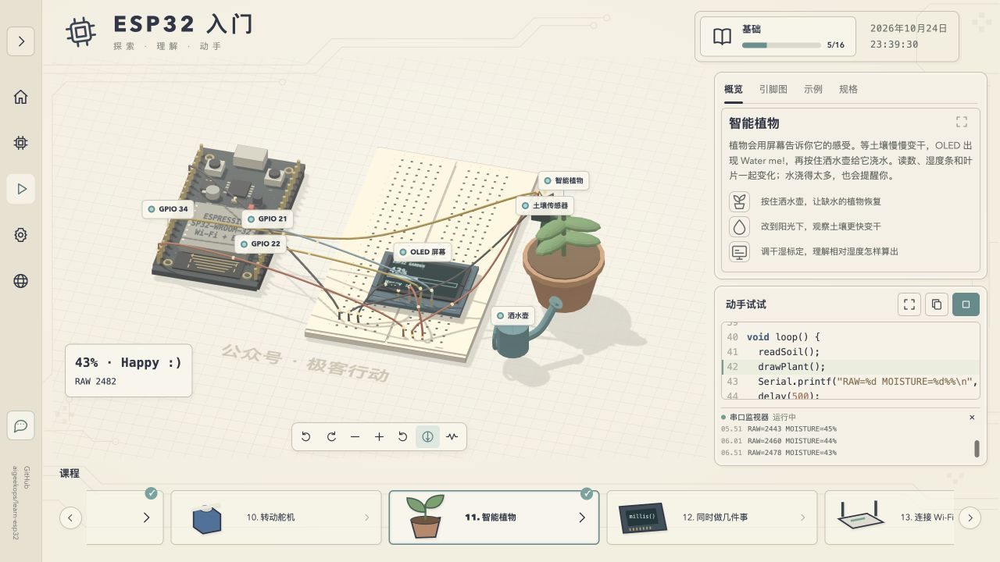

# 课程优化验收 v0.3

日期：2026-10-24。按用户确认的新 16 课目录实现。当前课程定义见 [CURRICULUM.md](CURRICULUM.md)，完整方案见 [CURRICULUM_REDESIGN.md](CURRICULUM_REDESIGN.md)。

## 交付

- 串口融入各课，组合告警融入温度课；加入光控夜灯、迷你钢琴、智能植物。保留最后 4 课联网主线，综合课改为联网植物监测器。
- 旋钮课具有真实的输入到 PWM 调光反馈，RGB 课集中讲三通道混色。
- 新场景的 GND 与 3V3 通过面包板五孔组分配，每根跳线占独立插孔，开发板各使用一根公共主线；导通与孔位占用有必要测试。
- 新增独立绘制的光敏分压模块、台灯、八键钢琴、植物、土壤传感器及洒水壶模型；课程插图、元件说明、原理图和代码参数同步。
- 八个琴键支持场景按住、检查器按钮和键盘 1–8；最高编号按下键优先，松开静音，八度乘数同步影响模型和 C++。
- 植物环境随位置加速变干，按住洒水壶加水。土色/叶片响应环境湿润程度；OLED 与程序使用干湿标定后的相对百分比，显示湿度条及缺水/合适/过湿消息。
- 设备网页检查器可读湿度、设置缺水阈值；返回状态和 LED/声音/OLED 来自同一课程模型。原理图保持可点击、可与场景双向选中。
- 中英文概览要点与逐课示例讲解独立编写，围绕操作、现象、原理、代码展开。
- 展开侧栏的顶部按钮为 36×36 px、左对齐；公众号外层卡片背景/边框移除，仅二维码保留白底，GitHub 使用低对比文字。

## 验证

| 项目 | 结果 |
| --- | --- |
| 类型、构建、单文件及分发 | 通过；`build:standalone`、`check:dist` |
| 必要行为测试 | 13 项通过，涵盖 16 课代码/引脚/讲解完整性、亮灭/ADC、旋钮调光、光敏分压、温度报警、钢琴、干燥/浇水/标定、OLED 刷新、HTTP 读写，以及既有面包板/相机/元件说明 |
| 修改固件默认编译 | 11/11 通过：blink、button、knob、pwm、light、temperature、display、piano、plant、timing、project；Core 3.3.12，FQBN esp32:esp32:esp32 |
| 旋钮 | 浏览器将位置设为 0/100，读数为 ADC 0/PWM 0 和 ADC 4095/PWM 255，LED 从暗到亮 |
| 夜灯 | 台灯 0% → ADC 396/灯亮；100% → ADC 3963/灯灭 |
| 钢琴 | 键盘 Do 输出 262 Hz，松开 Note off；高八度 Sol 输出 784 Hz。实际点击首个场景琴键输出 524 Hz，松开静音并打开 Do 独立说明 |
| 植物 | 约 17% 显示 Water me!；实际按住洒水壶 3 秒恢复至约 53%，显示 Happy :)，叶片恢复绿色 |
| 联网植物 | 连接前请求失败；连接后 GET 返回湿度。POST 缺水阈值 45 返回新阈值，实际浇水后约 65% 返回 needsWater=false，与页面提示一致 |
| 原理图 | 点击土壤传感器：SVG 与场景同选 soil，并打开专属说明 |
| 控制台 | 关键路径未记录 error |

本次先编译 9 份逻辑修改的默认固件，再仅补编译新增串口输出的 blink/button，共 11 份；未重跑未改动的 5 份固件。完整日志在本地 `output/compile/courses-v2/` 与 `output/compile/courses-v2-additional/`，摘要保存于 [验证记录](validation/2026-10-24-courses-v2.json)。

整套 16 课的批量浏览器遍历未执行：自动审批按用户的批量测试约定要求先行确认。本次浏览器证据仅覆盖上表列出的关键路径。

## 证据与边界

浏览器运行的是参数化教学模型，未烧录或测量实物。光敏输入是相对亮度，土壤百分比是干湿两点标定的相对读数，不是绝对含水率；加速干燥和叶片变化用于教学，未模拟真实生长。植物课与综合课均为手动浇水，不包含水泵、驱动器或自动灌溉代码。

独立语法文章/示例保留其版本记录；本次不改写已单独维护的文章和快照。课程当前实现以 `src/lessons.ts`、`src/lesson-guide.ts` 和本次固件摘要为准。
