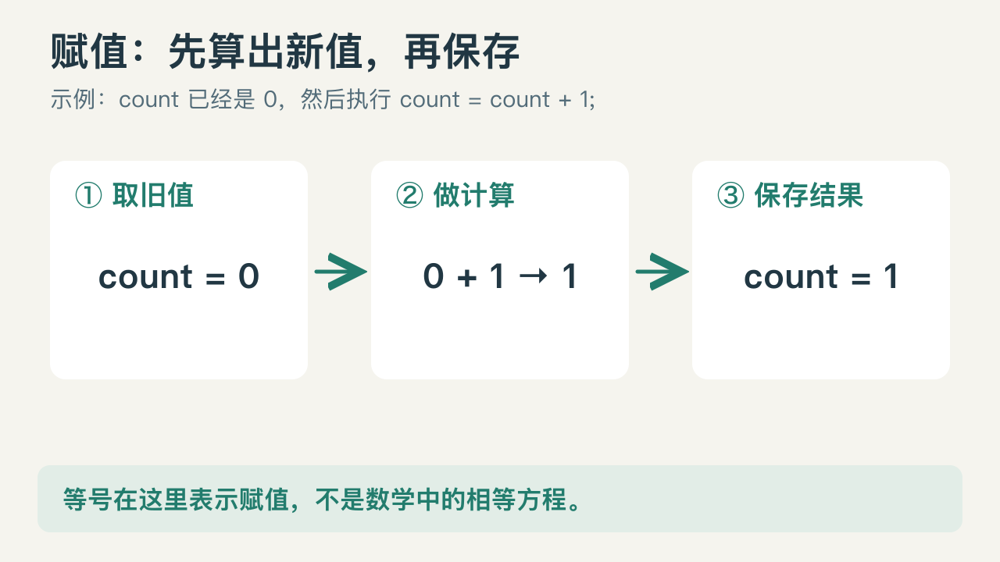
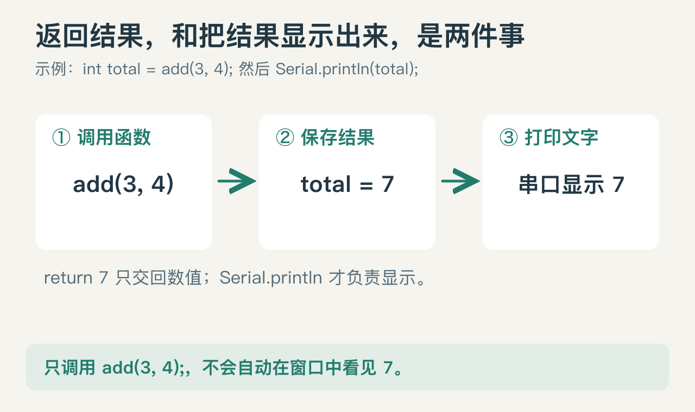
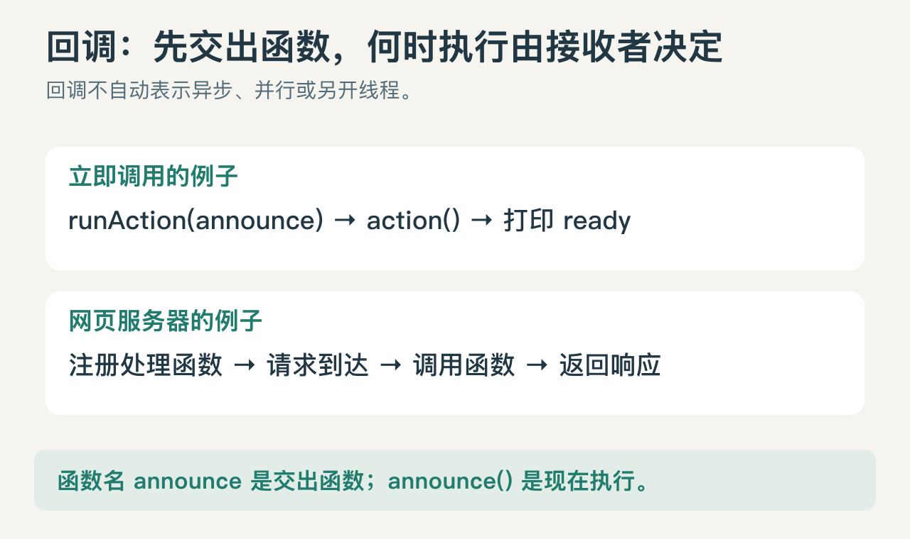

# 六个月学机器人⑦：Arduino / ESP32 语法入门，从零读懂并写出程序

前段时间，我做了一个 ESP32 交互学习项目，把闪灯、按钮、传感器、屏幕和联网等内容做成了可以在浏览器里动手操作的课程。关于这个项目，之前写过一篇介绍：

> 【前文链接待补：ESP32 交互学习项目介绍】

有些同学体验后反馈，课程里的现象能看懂，但读起程序还是有些吃力：知道按下按钮灯会亮，却不明白代码为什么这样写；跟着示例能运行，想自己改一点，又不知道该从哪里下手。

所以，我整理了这篇语法入门文章。从第一行代码讲起，把常见写法拆开说明，再逐步组合成完整程序。希望大家既能顺着读懂课程，也能开始自己写代码。

先看一行按钮课程里的代码：

```cpp
bool pressed = digitalRead(27) == LOW;
```

`bool` 是什么？为什么有一个等号又有两个等号？`27` 是什么？为什么按下反而叫 `LOW`？

这篇文章会按理解它们所需的顺序展开。先学习与器件无关的通用写法，再用 Arduino 和 ESP32 解释程序如何影响真实世界，最后逐步读懂网站里的完整课程代码。你不需要先读另一篇教程。

学完并完成文中的练习，你应当能做到：读懂常见 Arduino/ESP32 程序，自己写出条件控制、循环处理、函数与数据结构，使用库并查阅函数说明，把多个功能组成一个可解释的程序。文章覆盖日常入门开发的核心语法；更复杂的 C++ 技术仍需要后续按需学习。

这是一篇可以反复查阅的长文。第一次按顺序读，代码先手算再运行；之后遇到陌生写法，直接查对应部分。读完后的判断标准是“能解释、能修改、能独立写出来”，而不只是见过函数名。

## 阅读目录

- [1—3：程序怎样运行，第一份程序与基本符号](#starting)
- [4—7：变量、数字、运算和真假判断](#data)
- [8—11：分支、循环、函数和变量可见范围](#flow)
- [12—16：数组、字符串、地址、结构体与对象](#organization)
- [17—20：库、回调、调试和非阻塞计时](#programming)
- [21—28：把语法用到引脚、传感器、显示与网页](#applications)
- [29—33：读懂综合项目、查课程、真机准备与练习](#practice)

### 每一段读完，先检查自己会不会用

| 阅读阶段 | 读完后能做什么 |
|---|---|
| 1—11 节 | 手动追踪变量变化，自己写一个带判断、循环和函数的小程序 |
| 12—20 节 | 使用数组和字符串，把数据交给函数，读懂对象与回调，安排两个计时动作 |
| 21—28 节 | 解释引脚、传感器、屏幕与网页代码各自接收什么、产生什么结果 |
| 29—33 节 | 跟踪一个完整项目，并从空白程序开始完成小练习 |

不必一次背住全部符号。每完成一段，先用自己的话解释一遍，再动手改一个输入，验证结果是否符合预测。

本文示例使用 ESP32-DevKitC V4 / ESP32-WROOM-32E，软件为 Arduino-ESP32 3.3.12。先理解语法，准备上传实体板时再核对型号与版本。<strong>“完整程序”可以单独使用；“片段”必须放在文中说明的位置。</strong> 不要把几份完整程序的 `setup()` 和 `loop()` 直接拼接到一起。

<a id="starting"></a>
## 1. 写代码之前，先认识程序怎样运行

<strong>代码</strong>是我们写下的文字指令；<strong>程序</strong>是这些指令组成的整体。源文件保存代码，常见后缀有 `.ino`、`.cpp`、`.h`。后缀帮助开发工具知道文件的用途。

ESP32 是开发板上的芯片，负责执行程序。Arduino 提供了开发工具，以及控制引脚、通信等现成功能。我们编写的主要是 <strong>C++</strong>。Arduino 没有另外发明一整套独立语法。

从文字到运行，经过这几个步骤：

```text
编写源代码
  → 编译：检查写法，把代码转换为芯片能执行的指令
  → 链接：把程序用到的其他代码组合起来
  → 上传 / 烧录：把构建出的程序写入开发板
  → 运行：开发板执行程序，产生输出或响应输入
```

Arduino IDE 中的 <strong>IDE</strong> 指“集成开发环境”，就是把编辑、编译、上传等操作放在同一个应用中。所谓<strong>框架</strong>，是预先安排好程序入口、基础功能和调用规则的软件；我们在其规则内填入自己的逻辑。<strong>库</strong>是一组可重复使用的功能，例如显示文字或连接网络。

你会看到 <strong>API</strong> 这个词，可以先理解为“别人提供给你调用的功能及其用法”。例如 `digitalWrite(23, HIGH)` 是按规定的名字和参数，请求库设置引脚输出。读 API 说明，主要看输入、返回结果、会改变什么。

编译成功只说明代码满足构建条件，不表示接线和实际效果一定正确。调试时先区分：代码没编译过、程序没上传上去，还是已经运行但行为不对。[Arduino 构建过程](https://docs.arduino.cc/arduino-cli/sketch-build-process/)

## 2. 第一份程序：让它输出一句话

先不用接外部元件。下面是一份<strong>完整程序</strong>：

```cpp
#include <Arduino.h>

void setup() {
  Serial.begin(115200);
  Serial.println("Hello, ESP32!");
}

void loop() {
}
```

`Serial` 是 Arduino 提供的串口通信工具。串口监视器是开发工具中收看这些文字的窗口；在这里，先把 `Serial.println(...)` 理解成“显示括号里的内容”，它的具体写法稍后会拆开。

逐行读：

| 写法 | 此处做什么 |
|---|---|
| `#include <Arduino.h>` | 引入使用 Arduino 基础功能需要的说明 |
| `void setup()` | 定义一个叫 setup 的函数，用来做一次性的准备工作 |
| `{ ... }` | 里面的语句属于这个函数 |
| `Serial.begin(115200);` | 启动串口通信，使用 115200 的通信速率 |
| `Serial.println("Hello, ESP32!");` | 输出这段文字并换行 |
| `void loop() { }` | 定义反复运行的函数；这里暂时没有动作 |

<strong>函数</strong>是有名字的一段代码。<strong>定义函数</strong>是写出它要做什么；<strong>调用函数</strong>是要求它执行。例如 `setup` 中调用了 `Serial.begin` 和 `Serial.println`。

`void` 表示函数不交回一个结果值；空的 `()` 表示不要求传入数据。不是“函数不做事”。

Arduino 框架会这样运行：

```text
上电 / 复位 → 准备底层环境 → setup() 一次 → loop() 一次又一次
```

因此上面的问候语只输出一次。把 `Serial.println` 移进 `loop()`，就会不断输出。为了看清速度，可以在其后加 `delay(1000);`，表示当前代码等待约 1000 毫秒，即 1 秒。

<strong>先预测：</strong>如果 `setup()` 输出 `A`，`loop()` 输出 `B`，顺序是什么？答案是先一个 A，再不断出现 B；不是 A、B 交替。

### 怎样运行后面的片段

如果片段是 `int value = 3;`、`Serial.println(value);` 这类语句，先放进本节程序的 setup 里，运行一次观察结果。<strong>函数定义、class、struct 等整体定义放在 setup 和 loop 外面</strong>，不要把一个普通函数定义嵌进另一个函数体。

一个程序只有一份 setup 和一份 loop。遇到标记为“完整程序”的例子，用它替换整份示例；遇到片段，只把对应部分放在说明的位置。用真机执行前需要准备 Arduino IDE 和开发板，具体操作在第 31 节；暂时没有开发板，也可以先按文中给定的输入手动跟踪数值。


## 3. 先认识语句、括号、注释与名字

<strong>语句</strong>是程序执行的一个步骤，常用分号结束，例如 `int count = 0;`。<strong>表达式</strong>是能算出一个结果的写法，例如 `2 + 3`、`count > 0`。表达式可以放进语句里：`int sum = 2 + 3;`。除了算出值，有的表达式还会修改变量、写引脚或打印文字，这种额外改变叫“副作用”。

```cpp
// 这是单行注释：给人看的说明，不作为动作执行。
int count = 0;

/* 这是多行注释。
   适合解释一组代码的用途。 */
count = count + 1;
```

常见符号先记这些：

| 符号 | 作用 | 例子 |
|---|---|---|
| `;` | 结束语句 | `count = 1;` |
| `{ }` | 把多条语句组织成代码块 | 函数体、条件分支 |
| `( )` | 函数的参数，或指定运算先后 | `delay(1000)`、`(2 + 3) * 4` |
| `,` | 分隔多项输入 | `pinMode(23, OUTPUT)` |
| `"..."` | 一段文字，叫字符串 | `"Hello"` |
| `'...'` | 一个字符 | `'A'` |
| `//`、`/* */` | 注释 | 注释里的数字不会改变器件 |

C++ 通常不靠换行识别语句结束，分号才是关键。缩进是为了让人看出层次，花括号决定实际范围。不要在 `if (条件)` 后随手加分号，它可能把条件后面的动作变成无条件执行。

名字区分大小写：`Serial` 与 `serial` 不同，`HIGH` 与 `High` 不同。变量和函数名不能以数字开头；本文采用英文字母、数字和下划线，中文用于注释。`int`、`if`、`return` 之类是语言保留的<strong>关键字</strong>，不能拿来随便命名。

`HIGH`、`OUTPUT` 是库已经定义好的名字，不要加双引号。`HIGH` 可以表示电平，`"HIGH"` 则是四个字母组成的文字。

<a id="data"></a>
## 4. 变量、赋值与常量：给数据一个名字

变量用于保存程序运行时要使用的值：

```cpp
int count = 0;
count = count + 1;
```

第一行读成：“创建一个名叫 count、保存整数的变量，初始值为 0。”第二行先算右边的 `0 + 1`，再把 1 保存回 count。

| 步骤 | 当前 count | 正在做什么 |
|---|---:|---|
| 创建变量后 | 0 | 已保存初始值 |
| 计算右侧时 | 0 | 用旧值算出 0 + 1，结果为 1 |
| 赋值完成后 | 1 | 新值覆盖旧值 |

所以 `count = count + 1` 不是数学中的相等方程，而是一条“根据旧值计算新值，再保存”的命令。



<strong>声明</strong>是告诉程序某个名字及其类型；<strong>定义</strong>为这个名字提供实际对象或实现；`int count = 0;` 在此同时完成变量声明、定义和<strong>初始化</strong>。初始化是创建时给初值，后来的 `count = 5;` 叫赋值。

```cpp
int count = 0;          // 可以继续改变
const int LED_PIN = 23; // 运行中不能给 LED_PIN 重新赋值
```

`const` 表示只读约束。引脚编号、固定间隔等适合用常量，让代码表达含义：`delay(INTERVAL_MS)` 比散落很多个 500 更好修改。

`constexpr int MAX_ITEMS = 4;` 还要求这个值能在编译时确定，适合固定尺寸等用途。入门时先正确使用 `const`，再按需要区分二者。

不要读取未初始化的普通局部变量：

```cpp
int value;       // 放在函数内时，此处没有可依赖的初值
int ready = 0;   // 明确给出初值
```

<strong>小练习：</strong>`int a = 3; int b = a; a = 8;` 之后 b 是多少？是 3。给普通整数赋值时复制的是当时的值，不是建立“以后自动跟着 a 变”的关系。

## 5. 数据类型、位与字节：为什么不能全用 int

<strong>类型</strong>规定了一个值怎样保存、能做什么运算。整数保存完整个数，浮点数可表示带小数的数量，布尔值表示真假。

电脑把数据保存成 0 和 1。一个这样的单位叫<strong>位</strong>，英文 bit；本文平台上 8 位组成一个<strong>字节</strong>，byte。n 位无符号整数有 `2^n` 个组合：8 位可表示 0–255，共 256 个值。

| 常用类型 | 适合保存什么 | 例子 |
|---|---|---|
| `bool` | 真假：`true` 或 `false` | `bool enabled = true;` |
| `int` | 有正负的整数 | `int threshold = 30;` |
| `unsigned long` | 本文平台上 32 位非负整数 | `unsigned long startedAt = 0;` |
| `uint8_t` | 明确的 8 位无符号整数 | 颜色计数 0–255 |
| `uint32_t` | 明确的 32 位无符号整数 | 毫秒、毫伏计数 |
| `float` | 带小数的数，单精度浮点 | `float temperature = 25.5f;` |
| `double` | 另一种浮点类型；精度与平台有关 | ESP32 上通常比 float 精度高 |
| `char` | 一个字符，也可用于小整数 | `char command = 'A';` |
| `String` | 一段可操作的文字 | `String name = "ESP32";` |

<strong>有符号</strong>表示可以保存负数；<strong>无符号</strong>表示只保存非负数。`uint32_t` 可拆成 unsigned、integer、32 bit、type 来记。`int` 的位宽依平台变化：本文 ESP32 上通常为 32 位，经典 Uno R3 上通常为 16 位；需要明确大小时用 `uint32_t` 等固定宽度类型。

每种整数类型都有边界。无符号整数超过上限会按其位数回绕：

```cpp
uint8_t value = 255;
value++;  // 再保存回 8 位时变为 0
```

这不表示可以依赖有符号整数溢出；有符号溢出不是可靠的循环计数方式。

浮点数也不是精确小数账本，很多十进制小数只能近似表示。不要一概用 `measurement == 0.1f` 判断实际测量是否匹配；通常按业务允许的误差判断。打印多位小数也不会提高传感器精度。

例如允许温度在 29.5—30.5 °C 内都视为接近 30 °C，可以明确写：

```cpp
float measuredC = 30.2f;
bool nearTarget = measuredC >= 29.5f && measuredC <= 30.5f;
```

这里的容许范围来自你的测量要求，不是一条对所有浮点比较都适用的固定常数。

写在代码里的固定值叫<strong>字面量</strong>。常见后缀与进制：

| 写法 | 含义 |
|---|---|
| `25` | 整数字面量 |
| `25.0f` | float 字面量；`f` 不是单位 |
| `25.0` | double 字面量 |
| `1000UL` | unsigned long 字面量 |
| `255L` | long 字面量 |
| `0x3C` | 十六进制的 60 |
| `0b1010` | 二进制的 10 |

别给十进制整数随意加前导 0，C++ 可能按八进制解释。文中 `2^12` 是数学上的“2 的 12 次方”；<strong>C++ 的 `^` 是按位异或，不是乘方运算符</strong>。

## 6. 算术、类型转换与运算顺序

```cpp
int sum = 5 + 2;        // 7
int product = 5 * 2;    // 10
int quotient = 5 / 2;   // 2
int remainder = 5 % 2;  // 1
```

`%` 求整数除法的余数；除数不能为 0。整数除法向 0 截去小数，不会自动四舍五入。

```cpp
float a = 5 / 2;                 // 先得到整数 2，再保存为 2.0
float b = 5 / 2.0f;              // 2.5
float c = static_cast<float>(5) / 2; // 2.5
```

`static_cast<float>(5)` 是<strong>显式类型转换</strong>：明确要求把值转换成 float。自动进行的转换叫<strong>隐式转换</strong>，例如整数结果赋给 float。转换不能恢复先前已经丢失的信息，也不保证目标类型装得下。

```cpp
int whole = static_cast<int>(3.9f); // 3，丢弃小数，不是四舍五入
```

运算一般先算括号，再乘除和余数，再加减。别让读者猜复杂优先级，主动加括号：

```cpp
int x = 2 + 3 * 4;   // 14
int y = (2 + 3) * 4; // 20
```

`count += 2` 通常可读成 `count = count + 2`；还有 `-=`、`*=`、`/=`、`%=`。自增与自减：

```cpp
int count = 0;
int a = count++; // 先使用 0，再让 count 变 1
int b = ++count; // 先让 count 变 2，再使用 2
```

一条语句里不要多次修改同一个变量来“炫技”。例如把多个 `count++` 塞进同一次函数调用，会让执行顺序难以判断。括号能决定表达式怎样分组，并不保证所有函数参数都从左到右求值。需要先后顺序时，拆成多条语句。

课程中的 `value * 255L / 4095` 先乘后除，把 0–4095 换成 0–255；写成 `value / 4095 * 255`，大多数输入会先被整数除法变成 0。单位也要一致：1 秒 = 1000 ms，1 ms = 1000 μs，1 V = 1000 mV。

## 7. 比较、逻辑与位运算：分别处理真假和数字

`=` 保存新值；`==` 比较是否相等。比较表达式返回布尔值：

```cpp
int value = 30;
bool high = value >= 30; // true
bool same = value == 30; // true
bool other = value != 30; // false
```

`!` 表示取反，`&&` 表示两者都成立，`||` 表示至少一个成立：

```cpp
bool pressed = true;
bool enabled = false;
bool run = pressed && enabled; // false
bool wake = pressed || enabled; // true
```

它们会<strong>短路</strong>：左边已经决定结果时，不再求右边。例：`enabled && readButton()` 中，如果 enabled 为 false，`readButton()` 不会调用。把必须每轮执行的操作放到独立语句里。

`if (pressed = true)` 往往是错误：它先赋值，再把结果当条件，通常始终进入。布尔判断直接写 `if (pressed)` 更清楚。

C++ 中数字 0 转成 false，非零转成 true：`bool(0)` 为 false，`bool(2)` 也是 true。`bool(value)` 与 `static_cast<bool>(value)` 都能表达这里的转换。

逻辑运算与<strong>位运算</strong>不同。位运算处理整数中各个二进制位：

| 运算符 | 含义 | 非负小整数示例 |
|---|---|---|
| `&` | 按位与，两位都为 1 才为 1 | `0b1010 & 0b1100` 为 8 |
| `\|` | 按位或，至少一位为 1 | `0b1010 \| 0b1100` 为 14 |
| `^` | 按位异或，两位不同才为 1 | `0b1010 ^ 0b1100` 为 6 |
| `~` | 每个位取反 | 结果还取决于参与运算的类型位宽 |
| `<<`、`>>` | 按位移动 | `1U << 3` 为 8 |

入门控制逻辑多数用 `&&`、`||`，寄存器或状态标志中才常见 `&`、`|`。移位时要检查类型、位宽和移动数量，不能把超出边界的移位当成普通乘除。

<a id="flow"></a>
## 8. if、switch 与三元表达式：选择要执行的动作

```cpp
// 函数内片段
int score = 75;
if (score >= 90) {
  Serial.println("excellent");
} else if (score >= 60) {
  Serial.println("pass");
} else {
  Serial.println("retry");
}
```

依次判断，进入第一个成立的分支后，不再执行后面的 `else if`、`else`。这里输出 pass。如果写成三个独立的 if，就可能有多个分支都运行。

不要写 `if (10 <= value <= 50)` 表示范围。假设 value 为 100，程序先算 `10 <= 100` 得到 true，再把这个结果转成 1 与 50 比较，`1 <= 50` 仍为 true，错误地放行了 100。正确写法是 `value >= 10 && value <= 50`。

当选择取决于几个离散值时，可以用 `switch`：

```cpp
// 函数内片段
int mode = 2;
switch (mode) {
  case 1:
    Serial.println("manual");
    break;
  case 2:
    Serial.println("automatic");
    break;
  default:
    Serial.println("unknown");
    break;
}
```

`case` 是匹配值；`break` 离开 switch，避免继续运行后面的分支；`default` 处理都没匹配的情况。普通 switch 不用来直接匹配 String 文字。

只需要二选一得到一个值，可以写三元表达式：

```cpp
int brightness = enabled ? 255 : 0;
```

意思是 enabled 为 true 就取 255，否则取 0。这与下面的片段等价：

```cpp
int brightness;
if (enabled) brightness = 255;
else brightness = 0;
```

三元表达式适合简短选择。连续嵌套时，先拆成 if/else 读懂，再决定是否压成一行。

## 9. for、while、do...while：重复执行一段代码

```cpp
// 函数内片段
for (int i = 0; i < 3; i++) {
  Serial.println(i);
}
```

执行顺序：初始化 i=0 → 检查 i<3 → 输出 → i++ → 再检查。结果是 0、1、2，共三次；i=3 时退出。

| 检查时的 i | i < 3 是否成立 | 本轮输出 | 之后发生什么 |
|---:|---|---|---|
| 0 | true | 0 | i 增加为 1 |
| 1 | true | 1 | i 增加为 2 |
| 2 | true | 2 | i 增加为 3 |
| 3 | false | 没有输出 | 离开循环 |

条件检查了 4 次，循环体执行了 3 次。数组处理里常见的 `i < count`，就是为了让最后一个有效索引停在 count−1。

如果不知道要重复多少次，但知道何时继续，可以写 while：

```cpp
int remaining = 3;
while (remaining > 0) {
  Serial.println(remaining);
  remaining--;
}
```

先判断再执行。`do...while` 则先执行一次，再判断，所以至少执行一次；末尾有分号：

```cpp
int remaining = 0;
do {
  Serial.println("once");
} while (remaining > 0);
```

控制循环的三个动作：

| 写法 | 离开什么 / 跳过什么 |
|---|---|
| `break;` | 离开最近一层循环或 switch |
| `continue;` | 跳过本轮剩余部分，继续下一轮循环 |
| `return;` | 离开整个当前函数，不只是循环 |

在 for 中，continue 后仍会执行这一轮的自增部分。嵌套循环每层有自己的重复过程，break 不会自动同时退出所有层。

`loop()` 与 for/while 是不同层次：loop 是框架反复调用的函数；for/while 在<strong>这一次函数调用内部</strong>重复执行。若在 loop 中写永远不结束的 while，后面的语句就到不了。

## 10. 函数：输入、处理、返回结果

先用与硬件无关的例子：

```cpp
int add(int left, int right) {
  int result = left + right;
  return result;
}
```

这叫函数定义。最前面的 int 是<strong>返回类型</strong>，说明交回一个整数；left、right 是<strong>形参</strong>，是函数内部接收输入的名字。

```cpp
int total = add(3, 4);
```

3、4 是这次调用的<strong>实参</strong>，按位置分别交给 left、right。执行函数体后，return 把 7 交回，保存进 total。传参不是靠名字自动对应，而是按参数位置和类型规则匹配。

```text
调用 add(3, 4)
  → left 得 3，right 得 4
  → result 得 7
  → return 7
  → 调用点得到 7，继续执行下一条语句
```

<strong>return 与打印是两件事。</strong> `add(3, 4)` 计算出 7，只把结果交回调用者，不会自动出现在串口窗口。

```cpp
int total = add(3, 4); // 取得并保存结果
Serial.println(total); // 把保存的值显示出来
```

只写 `add(3, 4);`，结果会被丢弃；只打印一个变量，也不会替你重新计算之前的函数。先分清“取得结果”“保存结果”“显示结果”，读复杂程序会轻松很多。



没有返回结果的函数写 void；可以用 return 提前结束：

```cpp
void printPositive(int value) {
  if (value <= 0) return;
  Serial.println(value);
}
```

返回类型不是 void 的函数，要保证运行到应返回的地方时交回正确类型的值。写 `int add(...);` 只是<strong>函数声明</strong>，说明名字和输入输出；写 `{ ... }` 才给出实现。

### 默认参数与函数重载

```cpp
int multiply(int value, int factor = 2) {
  return value * factor;
}
```

`multiply(3)` 使用默认 factor=2，得到 6；`multiply(3, 4)` 得到 12。通常从参数列表右侧设置默认值；多文件时默认值一般只在声明中给出一次。

同名函数可以接收不同参数，这叫<strong>重载</strong>。例如库可以分别处理整数和小数：

```cpp
int twice(int value) { return value * 2; }
float twice(float value) { return value * 2.0f; }
```

`twice(3)` 与 `twice(3.5f)` 根据参数选择对应版本。不能只靠返回类型不同来重载。

这也解释了串口一个易错点：`Serial.println(25.5f, 1)` 的第二个参数表示小数位数；`Serial.println(25, HEX)` 的第二个参数表示整数输出进制。看起来相似，具体含义由选中的函数版本决定。

## 11. 作用域、生命周期、全局与 static

<strong>作用域</strong>回答“这个名字在哪里可用”；<strong>生命周期</strong>回答“它对应的数据存在多久”。两者不是一回事。

```cpp
int sharedCount = 0; // 函数外：全局变量

void example() {
  int localCount = 0; // 函数内：本次调用的局部变量
  sharedCount++;
  localCount++;
  Serial.println(sharedCount);
  Serial.println(localCount);
}
```

连续调用两次 example，会分别打印 `1、1` 和 `2、1`。全局值保留，普通局部值每次进入重新初始化。

```cpp
void countCalls() {
  static int count = 0;
  count++;
  Serial.println(count);
}
```

这里 count 只初始化一次，跨调用保存，依次输出 1、2、3；但名字仍只在这个函数里可用。这是 static 局部变量。

花括号也形成作用域：

```cpp
if (true) {
  int inside = 10;
  Serial.println(inside);
}
// Serial.println(inside); // 这里看不到 inside
```

不要在内层随意创建与外层同名变量，否则内层名字可能遮住外层，看起来“改了”，实际改的是另一份值。

RAM 是运行时保存变量的内存；Flash 是可长期保存固件等数据的存储。普通全局变量与 static 局部变量都不等于已经把运行中的修改保存到 Flash。复位或断电后重新运行，仍按程序初值开始。

<a id="organization"></a>
## 12. 数组：处理一组同类数据

```cpp
int readings[] = {10, 20, 30};
```

数组把同类型的多个元素排在一起。<strong>索引</strong>是元素位置编号，从 0 开始：readings[0] 为 10，readings[1] 为 20，readings[2] 为 30。

```cpp
readings[1] = 25;
for (int i = 0; i < 3; i++) {
  Serial.println(readings[i]);
}
```

输出 10、25、30。长度为 3 的数组，不能访问 readings[3]；C++ 通常不会自动替你拦住越界访问。

`int values[4] = {};` 创建 4 个值为 0 的整数；`int values[4];` 若是普通局部数组，则不能假定已经清零。

```cpp
const size_t count = sizeof(readings) / sizeof(readings[0]);
```

`sizeof` 取得字节数；数组整体字节数除以单个元素字节数，就得到元素数量。`size_t` 是表示大小和数量的无符号整数类型。

还可以使用范围 for：

```cpp
for (int value : readings) {
  Serial.println(value);
}
```

`:` 在这里表示依次取出数组元素；value 是每个元素的副本。想修改原元素，可以在理解下一节引用后写 `for (int& value : readings)`。

固定数组的尺寸创建后不会自动增加。函数接收普通数组参数时通常只得到其首元素位置，不能再靠同样的 sizeof 公式得知原数组长度；需要同时传长度，稍后在指针一节示范。

## 13. 字符、C 字符串与 Arduino String

`'A'` 是一个字符；`"A"` 是字符串。英文字符常占一个字节，中文的显示字符在 UTF-8 中通常占多个字节，所以“字节数量”不总等于“你看到的字数”。

常见转义写法用于在文字中表示特殊内容：

| 写法 | 放进文字里的内容 |
|---|---|
| `\n` | 换行 |
| `\t` | 制表符 |
| `\"` | 双引号 |
| `\\` | 反斜杠 |
| `\0` | 零字符，C 字符串结束标记 |

### 两种常见的文字表示

```cpp
char name[] = "ESP32";
const char* label = "ESP32";
String message = "ESP32";
```

第一行创建可修改的字符数组，末尾额外保存 `\0`，所以有 6 个字节。第二行保存一段只读文字的位置，星号的地址含义下一节解释。第三行创建 Arduino String 对象，让库管理文字内容和长度。

“存储空间有多大”与“文字内容有多长”也不同：`char text[10] = "ABC";` 有 10 字节空间，当前内容长度为 3，接下来是结束标记。strlen 会从开头数到零字符，但不把零字符计入长度，所以 `strlen(text)` 得到 3；`sizeof(text)` 得到整个数组大小 10。复制更多文字前，要为结尾的零字符也预留一格。

```cpp
String message = "ESP32";
message += " ready";
Serial.println(message.length()); // 11
Serial.println(message == "ESP32 ready"); // 比较内容，结果 true
```

`length()` 返回内容长度，`+=` 在后面接文字。String 的 `==` 比较内容；`const char*` 的 `==` 比较地址，比较 C 字符串内容要使用 `strcmp`，相同返回 0，例如 `strcmp(label, "ESP32") == 0`。

### 数字与文字要明确转换

```cpp
int value = 30;
String text = String("value=") + String(value);
int parsed = String("30").toInt();
```

String(value) 把数值变文字，toInt() 尝试把文字转整数。但 `"30abc"` 可能得到 30，非法文字可能得到 0，因此解析不等于校验，必须先明确允许什么输入。

不要把 `"value=" + value` 当字符串拼接，这可能变成地址偏移。要么显式用 String，要么分两次 `Serial.print`。

String 会按需要使用内存，普通短文本很方便；持续增长、无上限保存输入仍会耗尽内存。`const char* p = message.c_str();` 可以取得供 C 接口读取的地址，但 message 被修改或销毁后，p 可能失效，不能把它当作永远有效的副本。

## 14. 地址、指针与引用：把“值”和“值在哪里”分开

变量的数据保存在内存中。<strong>地址</strong>用于定位这块数据；<strong>指针</strong>是保存地址的变量：

```cpp
int value = 3;
int* pointer = &value;
*pointer = 4;
```

依次读：value 保存 3；`&value` 取得它的地址；pointer 保存该地址；`*pointer` 沿地址找到原数据并写入 4，所以 value 也变成 4。

| 出现位置 | `*` 或 `&` 的意思 |
|---|---|
| `2 * 3` | 乘法 |
| `int* p` | 声明一个指向 int 的指针 |
| `*p` | 沿指针访问数据，叫解引用 |
| `&value` | 取地址 |
| `int& reference = value` | 给原变量一个引用名 |
| `a & b` | 前面讲的按位与 |

<strong>引用</strong>可理解为已有对象的另一个名字：

```cpp
int value = 3;
int& alias = value;
alias = 8; // value 变成 8
```

函数参数默认常见的是传值：收到一份副本。引用参数则能访问原值：

```cpp
void changeCopy(int value) { value = 9; }
void changeOriginal(int& value) { value = 9; }
```

如果 x=3，调用 changeCopy(x) 后仍为 3；调用 changeOriginal(x) 后为 9。`const String& text` 表示只读地引用原 String，通常能避免复制整段文字。

传递数组时常用“地址 + 数量”：

```cpp
int sumValues(const int* values, size_t count) {
  int sum = 0;
  for (size_t i = 0; i < count; i++) sum += values[i];
  return sum;
}
```

若已经有 `int readings[] = {10, 20, 30};`，调用 `int total = sumValues(readings, 3);` 得到 60。readings 与形参 values 不需要同名：调用时把数组位置交给函数，函数用自己的参数名访问。调用者有责任传入真实有效的数量。const 表示此函数不通过 values 改写元素。仍要保证相加结果不会超出 int 范围。

`nullptr` 表示不指向有效对象。不能解引用空指针，也不能返回已经结束生命周期的局部变量地址。

还可能看到 `Device* p` 后使用 `p->method()`；`->` 表示通过对象指针访问成员，相当于 `(*p).method()`。对象本身使用点号，指向对象的指针使用箭头。

## 15. struct 与 enum：给一组数据和状态起名字

```cpp
struct Reading {
  float temperatureC;
  bool valid;
};

Reading current = {25.5f, true};
```

struct 定义一个新的类型，temperatureC 和 valid 叫<strong>成员</strong>。`current.temperatureC` 访问这个对象中的温度。结构体最后的分号不能漏。

状态适合用枚举表达：

```cpp
enum Mode { STOPPED, RUNNING, PAUSED };
Mode mode = STOPPED;
```

这里不用自己记住“0 是停止，1 是运行”。枚举的名字让逻辑更清楚；普通枚举未指定值时，第一项从 0 开始依次递增。

```cpp
enum class AlarmState { Normal, Alarm, Acknowledged };
AlarmState state = AlarmState::Normal;
```

enum class 把名字放进类型范围，`::` 表示“这个范围里面的名字”。用哪一种都要在程序里保持一致。

状态不会自行推进，需要代码明确判断何时从某个值变成另一个值。状态机就是这种“记住当前状态，依据输入决定下个状态”的组织方式。

## 16. 类、对象、构造函数与方法

<strong>类</strong>描述一类对象保存哪些数据、提供哪些操作；<strong>对象</strong>是按这个类型创建的一份具体内容。成员函数也叫<strong>方法</strong>。

```cpp
class Counter {
public:
  Counter(int start) : value(start) {}
  void increment() { value++; }
  int current() const { return value; }

private:
  int value;
};
```

逐项解释：

- `class Counter` 定义类型，末尾需要分号。
- `public` 后的内容允许使用者访问；`private` 后的数据只允许类自身等具有权限的代码访问。
- `Counter(int start)` 与类同名，是<strong>构造函数</strong>，创建对象时执行，没有返回类型。
- `: value(start)` 是成员初始化列表，表示创建时把 value 初始化成 start。
- `increment()` 修改计数，`current()` 返回计数。
- `current()` 后的 const 把当前对象当作只读；在这个例子中，它可以读取 value，不能给 value 重新赋值。

```cpp
Counter clicks(0);
clicks.increment();
Serial.println(clicks.current()); // 1
```

现在回看 `Serial.println(...)`：Serial 是库预先提供的对象，我们调用它的方法。`Adafruit_SSD1306 display(...)` 也属于创建对象，后面的 `display.print(...)` 是使用对象的方法。

`struct` 也能有方法；struct 默认公开成员，class 默认私有成员。对入门数据记录可以先用 struct；使用现成驱动类时，重点看构造参数、初始化方法、普通操作方法和返回值。

<a id="programming"></a>
## 17. 头文件、库、宏与多文件程序

`#include <Arduino.h>` 是预处理指令，构建程序前先按它引入头文件内容。<strong>头文件</strong>通常提供类型与函数声明，让编译器知道怎样使用某些功能；实现可能位于库的其他文件中。

- `<Wire.h>` 常表示使用安装环境或库中的头文件。
- `"sensor.h"` 常用于自己项目中的头文件，先从相应项目位置查找。
- `#include` 不会替你从网上自动安装库。

文件多起来时，可以这样组织。以下三个文件属于同一个 sketch 项目：

```cpp
// math_helpers.h
#pragma once
int add(int left, int right);
```

```cpp
// math_helpers.cpp
#include "math_helpers.h"
int add(int left, int right) {
  return left + right;
}
```

```cpp
// 主 .ino
#include <Arduino.h>
#include "math_helpers.h"
void setup() {
  Serial.begin(115200);
  Serial.println(add(3, 4));
}
void loop() {}
```

`#pragma once` 防止一个头文件在同一编译单元里被重复处理；编译单元可先理解为一个源文件连同它引入的头文件。不要直接 include 一个 `.cpp` 再让它被单独编译，以免出现重复定义。

Arduino 工具通常会帮助 `.ino` 生成部分函数声明；普通 `.cpp` 仍要自己安排声明与包含关系。弄懂声明与定义后，就不会只看到 `undefined reference` 便盲目重装库。

另一个常见指令是宏：

```cpp
#define STATUS_PIN 23
```

它在预处理阶段进行文本替换，没有普通变量的类型规则。固定数值通常优先写 `const int STATUS_PIN = 23;` 或 constexpr。函数式宏还可能重复求值，不能把它一概当普通函数。

`#if`、`#ifdef`、`#else`、`#endif` 在<strong>编译时</strong>选择哪些代码参与构建；普通 if 在<strong>运行时</strong>判断。`extern int count;` 常用来声明“这个全局变量在别处定义”，仍要在一个源文件中真正定义它。

## 18. 函数名、回调与 Lambda：把“稍后要做的事”交给别人

```cpp
void announce() {
  Serial.println("ready");
}
```

`announce()` 是现在调用，`announce` 是这个函数的名字。把函数交给另一个函数，之后再调用它，常称为<strong>回调</strong>。

```cpp
void runAction(void (*action)()) {
  action();
}
```

`void (*action)()` 表示一个函数指针：指向“不接收参数、返回 void 的函数”。调用 `runAction(announce)`，runAction 再调用 action，便执行 announce。

```text
runAction(announce)
  → action 指向 announce
  → runAction 内调用 action()
  → 执行 announce()，打印 ready
  → 回到 runAction，再回到原来的调用位置
```

这里回调立即在 runAction 内发生；网页服务器可能先保存回调，等请求到达再调用。<strong>回调只说明“交给另一段代码调用”，不自动意味着异步、并行或另外开一个线程。</strong>



写一个没有名字的小函数，可以用 Lambda：

```cpp
runAction([]() {
  Serial.println("ready");
});
```

`[]` 是捕获列表，`()` 是参数列表，`{}` 是函数体。所谓<strong>捕获</strong>，是让 Lambda 使用定义它时所在位置的某些局部变量：

```cpp
int limit = 30;
auto saved = [limit](int value) { return value >= limit; };
limit = 40;
bool result = saved(35); // true：按值捕获了原来的 30
```

`auto` 让编译器根据初始值推断变量类型，不表示这个变量可以随意变成另一种类型。这里 Lambda 有自己独特的类型，用 auto 很自然。

`[limit]` 保存一份值，`[&limit]` 引用原变量；后者要求原变量在回调使用期间仍存在。引用了已经结束生命周期的局部变量，是常见错误。空捕获 `[]` 不捕获局部变量，但仍可以访问合适的全局变量。

带捕获的 Lambda 不能直接当作上述普通函数指针使用；有些库接收的是更灵活的可调用对象，所以允许带捕获。以库规定的参数类型为准，不能把所有回调都当成同一种接口。

## 19. 输出、观察与排错：让程序说明自己在做什么

串口三种常见操作：

```cpp
Serial.print("count=");       // 不自动换行
Serial.println(3);            // 输出 3 后换行
Serial.printf("count=%d\n", 3); // 按格式组织文字
```

串口监视器是收看日志的窗口，程序先调用 `Serial.begin(115200)`，窗口也选择 115200。115200 的单位是波特率，用于配置通信速率，不是每秒打印多少条日志。

printf 的第一个参数是格式字符串，后续参数依次填入占位位置：

| 格式 | 放什么 |
|---|---|
| `%d` | int；bool 传进这里时会提升为 int |
| `%lu` | unsigned long |
| `%.1f` | 浮点数，显示一位小数 |
| `%s` | 以零字符结束的 C 字符串 |
| `%%` | 百分号本身 |

类型要匹配。例如 uint32_t 不要在每个平台上都直接假定对应 `%lu`，可以明确写 `static_cast<unsigned long>(value)`。本课 ESP32 支持 Serial.printf，其他 Arduino 核心可能要改用 print/println。

遇到问题，按顺序检查：

1. <strong>先看第一条有效编译错误。</strong> 缺分号或括号可能导致后续很多错误。
2. <strong>缩小代码。</strong> 只保留造成问题的功能，不同时修改五个地方。
3. <strong>打印输入和中间结果。</strong> 看原始读数、比较结果、状态变化，而不只是不断打印 running。
4. <strong>手动跟踪一轮。</strong> 写下每条语句后变量变成什么。

对 `value = value * 255L / 4095`，先看 value 原值，再看乘法结果，最后看整数除法。知道哪一步开始不对，才知道该改哪里。

常见报错：`was not declared in this scope` 查名字与作用域；`No such file` 查头文件和库；`multiple definition` 查重复实现；`undefined reference` 查声明对应的实现是否参与构建。

## 20. 时间与非阻塞：让程序推进多件事

### 20.1 先认识毫秒、时间戳与阻塞

`millis()` 返回本次运行以来经过的毫秒数。把这样的“某一时刻读数”保存下来，就得到一个<strong>时间戳</strong>。`now` 常指当前时间，`sampledAt` 常指上次采样时间，名字由我们自己选择。

<strong>阻塞</strong>表示当前这条执行路径要先等一项工作结束，才能继续后面的代码。例如：

```cpp
Serial.println("start waiting");
delay(5000);
Serial.println("after waiting");
```

这意味着第二条输出至少要等前面的等待结束。如果把读按钮等操作放在 delay 后面，它也要等。ESP32 上后台任务可能仍运行，但你的这条执行路径并不会同时跳到后面读取按钮。因此“用了 ESP32，有多个核心”不能自动解决这段业务代码的阻塞。

非阻塞方法是保存上一次发生的时间，每轮只问“现在到时间了吗”。到时间就做一次，没到就继续处理其他事。[Arduino Blink Without Delay 示例](https://docs.arduino.cc/built-in-examples/digital/BlinkWithoutDelay/)

### 20.2 一份完整的非阻塞程序

```cpp
#include <Arduino.h>

unsigned long countedAt = 0;
unsigned long reportedAt = 0;
unsigned long count = 0;

void setup() {
  Serial.begin(115200);
}

void loop() {
  unsigned long now = millis();
  if (now - countedAt >= 500) {
    countedAt = now;
    count++;
  }
  if (now - reportedAt >= 1000) {
    reportedAt = now;
    Serial.printf("count=%lu\n", count);
  }
}
```

配套文件：[通用非阻塞计时程序](examples/cooperative_timing/cooperative_timing.ino)。每约 500 ms 增加一次计数，每约 1000 ms 输出一次；两个条件分别管理各自的时间戳，没有用 delay 暂停整条流程。

<strong>手动跟踪：</strong>假设 loop 恰好在 500、1000、1500、2000 ms 检查，count 依次变为 1、2、3、4，在 1000 和 2000 ms 分别打印 2、4。真机实际调用时刻并不保证恰好落在这些整数点，因此要把这个表理解为给定时刻的推演，不是硬实时调度承诺。

### 20.3 为什么写 now - last，而不是 now >= last + interval

本文 ESP32 平台的 32 位毫秒计数大约每 <strong>49.7 天</strong>回绕一次。使用同类无符号时间戳相减，可以处理跨过一次回绕的普通短间隔：

```cpp
if (now - sampledAt >= interval) {
  sampledAt = now;
}
```

例如旧值为 4294967290，新值回绕为 10，两者按 32 位无符号减法得到 16 ms。

这个写法仍有使用条件：间隔应远小于整个计数周期，并且程序要足够频繁地检查，不能漏掉整整一个回绕周期。不要把时间戳放进 `int`，也不要把单位混成秒和毫秒。

`sampledAt = now` 表示从实际执行时刻重新计时，简单且不会主动追赶积压任务；`sampledAt += interval` 表示维持计划节拍，程序落后时可能连续追赶。它们是不同调度策略，本课程采用前者。

### 20.4 “没有 delay”不等于所有操作都即时返回

后面会用到的刷屏操作要传输数据，串口输出会占时间，某些网络调用可能等待。非阻塞设计还要看调用内部发生什么。对本课，先保证每轮不做长时间等待，再根据响应需求测量各段耗时，无需一开始引入多线程。

<a id="applications"></a>
## 21. 数字输入输出：从程序的真假到按钮与 LED

先把几个硬件词说清楚：

| 术语 | 在这里是什么意思 |
|---|---|
| 引脚 / GPIO | 开发板用来输入或输出信号的连接脚；GPIO23 是编号，不是从排针第一孔数第 23 个 |
| GND / 地 | 电路比较电压时使用的共同参考点 |
| 高低电平 | 两种电压状态；本文 ESP32 高电平约 3.3 V，低电平接近 0 V |
| LED | 发光二极管，接线有方向，需按电路要求串联限流电阻 |
| 输入 / 输出 | 从引脚读外部状态，或由引脚向外设置状态 |
| 上拉 | 用电阻把未被外部驱动的输入引向高电平，避免它处于不确定状态 |

三项基础 API：

```cpp
// setup 中：
pinMode(23, OUTPUT);
pinMode(27, INPUT_PULLUP);
// loop 中：
digitalWrite(23, HIGH);
int level = digitalRead(27);
```

INPUT 表示输入，OUTPUT 表示输出；INPUT_PULLUP 还启用内部上拉。`digitalRead` 取得 HIGH/LOW，`digitalWrite` 设置输出。HIGH/LOW 与 bool 的 true/false 在这里可以发生数值转换，但前者描述电平、后者描述程序中的真假含义。

接线是 GPIO27 → 按钮 → GND：

```cpp
pinMode(27, INPUT_PULLUP);
```

`INPUT_PULLUP` 打开内部上拉。未按下时输入被拉向高电平；按下后连到 GND，变成低电平。

```cpp
bool pressed = digitalRead(27) == LOW;
```

按这行的数据依赖拆开：先取得引脚读数，再与 LOW 比较，最后把比较结果保存为 `pressed`。这不表示所有 C++ 表达式都按“从右往左”的顺序执行。物理电平为 LOW，但“是否按下”这个语义变量为 true，两者并不矛盾。

再加入一个模式变量 inverted，表示是否反转控制方式：

```cpp
bool inverted = false;
bool lit = pressed != inverted;
```

`inverted=false` 表示“按住亮”，`inverted=true` 表示“按住灭”。课程也可能把配置直接写成 `bool(0)` 或 `bool(1)`：它们分别是 false 和 true，与这里传入对应模式值的含义相同。

这里的 `!=` 对两个布尔值相当于“是否不同”：

| pressed | inverted | lit |
|---|---|---|
| false | false | false |
| true | false | true |
| false | true | true |
| true | true | false |

“按住亮”和“按一次切换”是两种需求。前者判断当前状态；后者要识别按下事件，并处理机械抖动。不能用 `if (pressed) lit = !lit;` 实现按一次切换，因为一次按住可能经历几千轮 `loop()`，灯会翻转几千次。第 26 节会把按住状态变成一次按下事件。机械按钮接触瞬间可能反复通断，称为“抖动”；过滤这些短暂变化叫“消抖”。

## 22. 模拟输入与 PWM：数字怎样对应连续变化

### 22.1 ADC 数值不是电压本身

<strong>模拟量</strong>指电压等可连续变化的量。<strong>ADC</strong> 是模数转换器，把输入电压转为整数编码。<strong>采样</strong>是读取某一时刻的输入。<strong>分辨率</strong>描述可区分多少个编码，<strong>量程</strong>描述能测的范围，<strong>精度</strong>描述结果偏离真实值多少。三者不能互换。

电位器是带可移动接触点的电阻器件；本课两端接 3V3/GND，中间滑动端把变化电压送到 GPIO34。

```cpp
analogReadResolution(12);
analogSetPinAttenuation(34, ADC_11db);
int raw = analogRead(34);
```

这三行分别是：把返回编码设为 12 位；设置 GPIO34 输入的<strong>衰减档位</strong>；读取一次并保存结果。衰减可以先理解为让较大的输入电压适配 ADC 内部测量范围的配置，它会影响量程，不是把精度或位数变大。raw 的名字常表示“原始数据”，是我们自己起的变量名。

12 位表示 `2^12 = 4096` 个编码，编号 0–4095。这个范围描述的是数字，不等于输入电压必然线性覆盖 0–3.3 V。

当前网站用理想化的约 0–3.1 V 映射。官方给经典 ESP32 的 `ADC_11db` 可测范围约为 150–3100 mV；真实输入低端、饱和、误差、噪声都需要留意。`analogRead()` 返回原始值，`analogReadMilliVolts()` 返回经过校准换算的毫伏值；校准不代表测量完全没有误差。[Espressif ADC 文档](https://docs.espressif.com/projects/arduino-esp32/en/latest/api/adc.html)

ADC1、ADC2 是芯片中两组模拟采样资源的名字。本课用 GPIO34/35 对应的 ADC1。它们是仅输入引脚，不能拿去驱动 LED，也没有可供本课使用的内部上拉。对经典 ESP32，使用 Wi-Fi 时应特别注意 ADC2 与无线功能的资源冲突；不要随意把传感器从 ADC1 搬到 ADC2。[经典 ESP32 GPIO 限制](https://docs.espressif.com/projects/esp-idf/en/stable/esp32/api-reference/peripherals/gpio.html)

### 22.2 PWM、频率、周期和占空比

<strong>PWM</strong> 是脉冲宽度调制，可以先理解为快速地开、关输出。<strong>周期</strong>是一轮完整重复花的时间，<strong>频率</strong>是一秒重复多少次，单位 Hz；5000 Hz 就是一秒 5000 轮。<strong>占空比</strong>是每轮中高电平持续时间所占比例。50% 表示一半高、一半低。

```cpp
ledcAttach(23, 5000, 8);
ledcWrite(23, 128);
```

第一行配置 GPIO23、5000 Hz、8 位占空比分辨率。第二行用 8 位计数 128 表示约半占空比。LEDC 是 ESP32 用来产生这类 PWM 输出的硬件功能，ledc 开头的 API 负责配置或使用它。示波器上看到的是高低电平脉冲；LED 的视觉亮度与占空比相关，但不保证人眼感觉严格线性。

PWM 频率、分辨率受硬件计时资源限制，不能任意组合。`ledcAttach()` 会返回是否配置成功。学习真机时可以在 `setup()` 检查：

```cpp
if (!ledcAttach(23, 5000, 8)) {
  Serial.println("PWM attach failed");
  while (true) delay(1000);
}
```

Arduino-ESP32 3.x 使用按引脚配置的 API。网上旧例中的 `ledcSetup`、`ledcAttachPin` 属于旧版接口，不能把新旧写法混着抄。[LEDC 文档](https://docs.espressif.com/projects/arduino-esp32/en/latest/api/ledc.html)、[2.x → 3.0 迁移说明](https://docs.espressif.com/projects/arduino-esp32/en/latest/migration_guides/2.x_to_3.0.html)

### 22.3 拆开课程里的长表达式

先明确两个输入：value 是旋钮的 ADC 原始读数，fromKnob 为 true 时使用旋钮控制，为 false 时使用固定亮度。假设当前得到 value=2048：

```cpp
int value = 2048;
bool fromKnob = true;
ledcWrite(23, fromKnob ? (value * 255L / 4095) : 255);
```

这几行假定对应 PWM 引脚已经初始化，重点是读懂第三行。它等价于下面的片段：

```cpp
long duty;
if (fromKnob) {
  duty = value * 255L / 4095;
} else {
  duty = 255;
}
ledcWrite(23, duty);
```

`?:` 只是把二选一写短，不是另一种神秘控制机制。

把长表达式翻译成一次具体运行：

| 层次 | 本次输入或结果 | 中文意思 |
|---|---|---|
| 模式判断 | fromKnob=true | 选择问号后、冒号前这一项 |
| 数值计算 | 2048 × 255 ÷ 4095 → 127 | 把旋钮读数换成 PWM 计数，小数被整数除法截去 |
| 函数调用 | ledcWrite(23, 127) | 将计数 127 交给 GPIO23 的 PWM 输出 |

如果只把 fromKnob 改为 false，选择的就是冒号后面的 255，不会使用旋钮计算结果。

“映射”表示把一个数值范围按公式换成另一范围，“限幅”表示把超出边界的值压到边界以内。

当 `value = 2048` 时，整数计算得到 `127`；当 `value = 4095` 时，得到 `255`。本课三个颜色各有独立输出和限流电阻：GPIO23 红、19 绿、18 蓝。共阴极 RGB 的公共脚接地；共阳极器件不能照搬相同接法和逻辑。

`map(raw, 0, 4095, 0, 255)` 的五项参数依次是输入值、输入下限、输入上限、输出下限、输出上限。它也能表达整数映射，但它不会自动把越界输入限制到目标范围。需要限幅时可以用 `constrain(value, 0, 255)`：低于 0 返回 0，高于 255 返回 255，中间返回原值。调用参数尽量只放已经算好的值，不把自增等有副作用的表达式塞进去。映射、限幅和输入是否合法，是三个不同问题。

## 23. 用一个返回值连接硬件与公式：温度换算

<strong>阈值</strong>是人为设置的判断界限，比如“温度达到 30 °C 就亮灯”。传感器负责产生读数，阈值决定怎样根据读数动作。

TMP36 的近似关系是：0 °C 对应 500 mV，每升高 1 °C 增加 10 mV。因此 25 °C 对应约 750 mV。[TMP36 数据手册](https://www.analog.com/media/en/technical-documentation/data-sheets/TMP35_36_37.pdf)

```cpp
float readTemperature() {
  return (analogReadMilliVolts(35) - 500.0f) / 10.0f;
}
```

逐层计算：

```text
analogReadMilliVolts(35) → 假设测到 750 mV
750 - 500.0f            → 250.0
250.0 / 10.0f           → 25.0 °C
return                  → 把 25.0 返回给调用者
```

`f` 表示 `float` 常量。使用浮点运算还能避免下面的无符号减法问题：

```cpp
uint32_t mv = 400;
// 不要先写 mv - 500 再期待得到 -100：无符号运算可能回绕。
float temperatureC = (mv - 500.0f) / 10.0f;  // 得到 -10.0
```

`digitalWrite(23, temperatureC >= 30)` 中，比较结果 true/false 会传给输出函数，控制亮灭。

<strong>动手：</strong>预测 500、750、800 mV 对应的温度，答案依次是 0、25、30 °C。不要把 TMP36 的公式直接套给 LM35、NTC 或数字温度传感器；器件不同，数据含义也不同。


## 24. 用库驱动屏幕：对象、总线与画面缓冲

<strong>OLED</strong> 是一种显示屏。<strong>I²C</strong> 是板卡与器件交换数据的一种通信约定，常用两根信号线：SDA 传数据、SCL 提供时钟。多器件共用这两根线组成<strong>总线</strong>，地址用于选择和哪一个器件通信。

<strong>驱动库</strong>负责把“画文字”转换成器件需要的操作；<strong>缓冲区</strong>是先在内存里准备内容的空间。先认识这些作用，再读 OLED 声明：

```cpp
#include <Wire.h>
#include <Adafruit_GFX.h>
#include <Adafruit_SSD1306.h>

Adafruit_SSD1306 display(128, 64, &Wire, -1);
```

- `Wire.h`：I²C 总线接口。
- `Adafruit_GFX.h`：文字和图形绘制能力。
- `Adafruit_SSD1306.h`：SSD1306 控制器驱动。
- `Adafruit_SSD1306`：类，也就是这种对象的类型。
- `display`：我们创建的对象名。
- 后面的括号：调用构造函数，传入屏幕宽、高、总线对象地址、复位引脚设置。
- `&Wire`：取现有 `Wire` 对象的地址，让屏幕驱动使用它。
- `-1`：这里表示不单独指定屏幕复位 GPIO，具体模块接法要与其要求一致。

这行代码“创建了软件对象”，并不意味着此时已经探测到实体屏幕。

```cpp
Wire.begin(21, 22);
if (!display.begin(SSD1306_SWITCHCAPVCC, 0x3C)) {
  Serial.println("OLED initialization failed");
  while (true) delay(1000);
}
```

`Wire.begin(21, 22)` 指定 SDA21、SCL22 并初始化总线。`SSD1306_SWITCHCAPVCC` 是库定义的屏幕电源工作方式选项，入门先按匹配的器件示例使用，不把它当语法关键字。

`0x3C` 是 I²C 地址，不是引脚。课程采用这个地址，但实际模块可能不同。要注意：对象构造时的括号在创建软件对象，begin 方法通常是在准备硬件，名称相似也要看具体库说明。`display.begin()` 的返回值反映库初始化结果；<strong>返回 true 也不能单独证明接线正确或屏幕确实响应</strong>。I²C 地址扫描、供电和实物显示仍需验证。

### 24.1 为什么写完文字后还要 display.display()

```cpp
// 片段：display 已初始化
float temperatureC = readTemperature();
display.clearDisplay();
display.setTextColor(SSD1306_WHITE);
display.setTextSize(1);
display.setCursor(0, 0);
display.println("ESP32 MONITOR");
display.setCursor(0, 24);
display.print(temperatureC, 1);
display.println(" C");
display.display();
```

逐项操作里，setTextColor 选择像素颜色，SSD1306_WHITE 是库定义的“亮像素”常量；setTextSize 设置文字倍率；setCursor(x, y) 设置从左上角计算的像素坐标；print/println 把文字写到当前位置。这里 print 的第二参数 1 表示保留一位小数。

前面是在内存中的画面缓冲区绘制；最后一行把画面送到屏幕。`clearDisplay()` 也先清缓冲区，不是立刻清实体屏。不同库可能采用不同刷新方式，要看库接口。[Adafruit SSD1306 示例](https://raw.githubusercontent.com/adafruit/Adafruit_SSD1306/master/examples/ssd1306_128x64_i2c/ssd1306_128x64_i2c.ino)

课程中这两行也值得单独读：

```cpp
if (millis() - drawnAt < 500) return;
drawnAt = millis();
```

不到 500 ms 就提前结束<strong>本次函数调用</strong>。写在 `loop()` 里时，框架随后还会再次调用 `loop()`，不是整个设备永远停止。如果你在这个 `return` 后面又加了必须每轮执行的按钮逻辑，它也会被跳过；综合项目中因此改为局部 `if` 块。

## 25. 用单位读懂声音与舵机代码

### 25.1 蜂鸣器：频率决定音高，周期窗口决定节奏

蜂鸣器用振动发声；本课使用需要外部交变信号的无源压电片。舵机则是接收控制脉冲、运动到目标附近的执行器，两者对波形的理解不同。

```cpp
// 片段：setup 中已经 ledcAttach(25, 2000, 10)
unsigned long phase = millis() % 1000;
ledcWriteTone(25, phase < 100 ? 2000 : 0);
```

`phase` 每秒循环经过 0–999。前 100 ms 输出 2000 Hz，剩下 900 ms 静音。

| 时间 | phase | 本轮输出 |
|---|---:|---|
| 50 ms | 50 | 2000 Hz |
| 150 ms | 150 | 静音 |
| 1050 ms | 50 | 2000 Hz |

这里有两个频率：约 2000 次/秒的音频振动，以及约 1 次/秒的鸣叫节奏。不要把它们混在一起。`millis() % 周期` 适合这种简单节奏演示；计数回绕时相位可能不连续，需要严格连续节拍时应管理独立时间状态。

本课器件是低负载无源压电片。带振荡电路的有源蜂鸣器、较大电流的蜂鸣器模块，不一定适用同样驱动方法。

### 25.2 舵机：核心量是高电平持续了多少微秒

课程代码：

```cpp
// setup 中配置：ledcAttach(18, 50, 16);
const int pulseUs = 1500;
uint32_t duty = lround(pulseUs * 65536.0 / 20000.0);
ledcWrite(18, duty);
```

拆开计算：

- 50 Hz 对应 20 ms，即 20000 μs 的周期。
- 1500 μs / 20000 μs = 7.5% 的高电平比例。
- 16 位计数周期为 65536 个刻度，本例输出计数约 4915。
- `lround()` 是数学函数，把结果舍入为 long 整数，恰好在中点时向远离 0 的方向舍入；本课均为正值，可按常见四舍五入理解。再把结果保存到 `uint32_t`。

公式使用“周期刻度数 65536”，并不表示可以无条件把 65536 当作合法占空比值写入。当前 1000–2000 μs 区间只对应约 3277–6554，远离满量程。

真实舵机的中位、角度、可用脉宽取决于型号和机械安装。网站中的角度是教学模型；不能据此断言任何舵机在 1000 μs 就精确为某个角度。先从中位、小范围调试，确认没有顶到机械端点。

舵机电源按器件规格选用；本课程示例采用独立稳压 5 V，并与 ESP32 共地。信号线接 GPIO18，不能把舵机电源接到 GPIO18。GPIO18 在 RGB 课用于蓝色、在舵机课用于信号，这是<strong>不同课程分别使用</strong>；合并程序时必须重新分配引脚和 PWM 资源。

## 26. 消抖与状态机：把语法组织成清楚的行为

### 26.1 enum 给状态起名字

```cpp
enum Alarm { NORMAL, ALARM, ACK };
Alarm state = NORMAL;
```

这定义了一种枚举类型和三个命名值。比记住“0 正常、1 报警、2 确认”更容易读。`state` 保存的是<strong>当前处在哪一种状态</strong>。

课程规则如下：

| 当前状态 | 输入条件 | 下一状态 | 灯 | 蜂鸣器 |
|---|---|---|---|---|
| 任意 | 温度低于阈值 | NORMAL | 灭 | 静音 |
| NORMAL | 温度达到或超过阈值 | ALARM | 亮 | 间歇响 |
| ALARM | 温度仍高，出现一次按下事件 | ACK | 亮 | 静音 |
| ALARM | 温度仍高，没有按下事件 | ALARM | 亮 | 间歇响 |
| ACK | 温度仍高 | ACK | 亮 | 静音 |

`ACK` 是 acknowledge，表示“已确认”。确认不等于温度恢复正常，所以灯仍亮。

对应片段：

```cpp
if (temperatureC < thresholdC) {
  state = NORMAL;
} else if (state == NORMAL) {
  state = ALARM;
} else if (state == ALARM && press) {
  state = ACK;
}
```

按顺序看：首先检查恢复正常；否则才处理高温状态。假设高温首次出现的同一轮也出现按钮事件，由于 `else if` 只执行一个分支，本课程会先进入 ALARM，不会在同一轮又进入 ACK。这是这段代码的确切语义。

课程没有加入温度迟滞：在阈值附近反复上下变化，状态可能反复重置。真实温度信号有噪声时，需要根据产品要求明确“触发阈值和恢复阈值是否不同”，而不是把网站的理想信号当作实际测量。

### 26.2 把“按着”与“刚按下”分开

课程消抖片段：

```cpp
// 持久状态：放在函数外，或声明为 static
bool stable = false;
bool candidate = false;
unsigned long changedAt = 0;

// 以下放在更新函数中；now 由 millis() 取得
bool raw = digitalRead(27) == LOW;
if (raw != candidate) {
  candidate = raw;
  changedAt = now;
}

bool press = false;
if (now - changedAt >= 30 && stable != candidate) {
  stable = candidate;
  press = stable;
}
```

四个名字分别表示：

- `raw`：这一瞬间读到的状态，可能抖动。
- `candidate`：最近出现、正在等待确认的候选状态。
- `stable`：持续至少 30 ms 后认可的稳定状态。
- `press`：只在从“松开”变为“按下”的那一轮为 true。

假设 100 ms 时开始按下，之后没有再抖动，到至少 130 ms 的某一轮才确认按下。下一轮 `stable == candidate`，不会再次产生 `press`。松开后也更新稳定状态，但 `press = stable` 得到 false，不会被当成按下事件。

`press` 每轮重新置为 false 是有意设计；`stable` 却必须跨轮保存。把二者都写成普通局部初值，或把 `press` 永久保留为 true，都会改变逻辑。

<strong>动手：</strong>按住按钮两秒，应该只产生一次确认事件；降温恢复 NORMAL 后再次升温，应该重新 ALARM。真机短按时间小于消抖窗口时，可能不会被识别，这也是明确的时间条件。


## 27. 联网前，先读懂网络角色和状态

网络中的常见名字先这样理解：

| 名字 | 作用 |
|---|---|
| Wi-Fi | 设备接入无线网络的方式 |
| SSID | 你在手机网络列表中看到的无线网络名称 |
| STA | 设备加入已有无线网络的工作模式 |
| IP 地址 | 网络中定位设备的地址 |
| 局域网 | 家里或办公室等一组彼此可通信的本地网络 |
| 协议 | 通信双方约定怎样组织和理解信息 |
| 客户端 / 服务器 | 发起请求的一方 / 接收并处理请求的一方 |
| 端口 | 同一个设备地址上区分不同网络服务的编号 |

```cpp
#include <WiFi.h>

const char* SSID = "YOUR_SSID";
const char* PASSWORD = "YOUR_PASSWORD";
```

`const char*` 可以先读作“指向一段只读文字”。`"YOUR_SSID"` 是字符串字面量，C 字符串末尾有零字符作为结束标志；不要尝试修改它的内容。

它与 `String` 不同：前者是指针，后者是管理字符串内容的对象。`const char*` 不能直接用 `==` 来可靠比较文字内容，它比较的是地址；C 字符串内容比较可用 `strcmp`。Arduino `String` 的 `==` 则由类提供了内容比较。

```cpp
// setup 片段
WiFi.mode(WIFI_STA);
WiFi.begin(SSID, PASSWORD);
```

STA 表示设备连接已有路由器。调用 `begin` 发起连接后，还要在后续检查：

```cpp
if (WiFi.status() == WL_CONNECTED) {
  Serial.println(WiFi.localIP());
}
```

“正在连接”“已获得可用网络状态”“已经能够访问服务器”是不同阶段。设备取得的 IP 应以真机串口为准。本文 WROOM-32E 使用 2.4 GHz Wi-Fi，手机和电脑还要能访问它所在的局域网。[Espressif Wi-Fi API](https://docs.espressif.com/projects/arduino-esp32/en/latest/api/wifi.html)

`WL_CONNECTED` 是库定义的“已连接”状态值，不是 C++ 关键字；`WiFi.status()` 返回当前状态，`WiFi.localIP()` 返回设备取得的 IP 地址。

课程定期查询连接状态，不在 `setup()` 中用无限等待把整个业务卡住。它也不是完整的网络可靠性框架；断网重连、请求超时、长期运行，需要在实际场景中验证。代码中的占位口令改为自己的值只保存在本地，不把真实口令提交到公开仓库。

## 28. HTTP、JSON 与网页：读懂代码里出现的其他语言

<strong>HTTP</strong> 是浏览器与设备交换请求、响应的协议。<strong>URL</strong> 是资源地址，例如 `http://192.168.1.20/api/state`：其中 IP 定位设备，`/api/state` 是路径；未写端口时，普通 HTTP 常用 80。<strong>路由</strong>就是根据请求路径和方法选择处理函数的规则。

GET 常用于读取，POST 常用于提交数据。<strong>JSON</strong> 是表达数据的文字格式：用键名对应值，例如 `{"temperatureC":25.0}`。键名要用双引号，值可以是数字、布尔值、字符串等。`application/json` 告诉接收者“这段内容采用 JSON 格式”；这类说明内容类型的文字也叫 MIME 类型。

### 28.1 注册路径和处理函数

先明确角色：<strong>本课 ESP32 是 HTTP 服务器，浏览器是客户端。</strong> “读取 HTTP 数据”指浏览器读取设备数据。若你想让 ESP32 请求天气 API，那是另一个客户端流程，通常使用 HTTPClient 等接口；本课没有实现它。

```cpp
#include <WebServer.h>
WebServer server(80);
```

`WebServer` 是类，`server` 是对象，80 是监听端口。

```cpp
server.on("/api/state", HTTP_GET, []() {
  server.send(200, "application/json", "{\"ok\":true}");
});
```

这段最容易看晕。先拆成三项参数：

1. `"/api/state"`：请求路径。
2. `HTTP_GET`：匹配 GET 请求。
3. `[]() { ... }`：请求到达时执行的函数。

`[](){}` 是 Lambda，俗称匿名函数：

```text
[]      捕获列表：这里不捕获局部变量
()      参数列表：这里没有参数
{ ... } 函数体：收到匹配请求后执行
```

`server.send(状态码, 内容类型, 正文)` 组织响应；`server.arg("value")` 读取请求参数，后面校验代码会用到它。“注册”是先保存路径与处理函数的对应关系。

它注册时不立即执行里面的 `server.send`。以这套同步 `WebServer` 用法为例，`loop()` 反复调用 `server.handleClient()`，由它处理请求并调用相应处理函数。[Espressif WebServer 示例](https://github.com/espressif/arduino-esp32/blob/3.3.12/libraries/WebServer/examples/HelloServer/HelloServer.ino)

### 28.2 从普通函数到路由回调

下面的<strong>片段</strong>表达同样逻辑；放在包含 `WebServer` 且已有全局 `server` 的程序中：

```cpp
void handleState() {
  server.send(200, "application/json", "{\"ok\":true}");
}

// 在 setup 中注册：
// server.on("/api/state", HTTP_GET, handleState);
```

注意注册的是 `handleState`，没有 `()`。`handleState()` 表示现在就调用；`handleState` 表示把这个函数交给服务器，以后再调用。

空捕获 `[]` 仍可以访问全局 `server`。如果回调要保存 `setup()` 中的普通局部变量，不能随便用 `[&]` 引用捕获，因为 `setup()` 返回后该变量可能已经失效。初学阶段像本课一样使用明确的全局设备状态，或理解生命周期后按值捕获。

### 28.3 JSON 与 C++ 字符串

真正发给浏览器的数据是：

```json
{"temperatureC":25.0}
```

在 C++ 的普通字符串里，内部双引号要转义：

```cpp
String body = String("{\"temperatureC\":")
            + String(temperatureC, 1)
            + "}";
```

- `\"`：在字符串内容里放一个双引号，不是提前结束字符串。
- `String(temperatureC, 1)`：把数值变成一位小数的文字。
- `+`：这里是 `String` 提供的字符串拼接，不是数字加法。

发送 `true` 与发送 `"true"` 也不同：前者是 JSON 布尔值，后者是字符串。动态文本包含引号、反斜杠或换行时，需要正确 JSON 编码；本课拼接固定键名与简单数值，不能推导为“任何用户输入都能直接拼进去”。

不要写 `"temperature=" + raw` 来拼接整数：字符串字面量加整数可能变成指针偏移。可写 `String("temperature=") + raw`，或直接分两次 `Serial.print`。

### 28.4 参数校验与状态回读

课程链路：

```text
点击网页 ON
  → 浏览器 POST /api/led，携带 value=1
  → ESP32 检查参数是否合法
  → 写 GPIO23
  → 返回响应
  → 浏览器 GET /api/state
  → 把回读结果显示出来
```

服务器的核心片段：

```cpp
String v = server.arg("value");
if (v != "0" && v != "1") {
  server.send(400, "application/json", "{\"error\":\"invalid value\"}");
  return;
}
digitalWrite(23, v == "1");
server.send(200, "application/json", "{\"ok\":true}");
```

校验就是检查输入是否满足允许的格式与范围。`return` 在这里结束本次处理函数，确保非法参数不会继续执行写灯。`&&` 表示“既不是 0，又不是 1”才拒绝。

| 状态码 | 本课程中的含义 |
|---|---|
| 200 | 请求被成功处理 |
| 400 | 参数不符合约定 |
| 404 | 路径没有对应处理器 |

回读让我们知道程序当前记录或读取到的控制状态。到了真机，还要观察 LED 是否真的亮了：插反或断线时，程序输出 HIGH，灯也可能不亮。

### 28.5 读懂 HTML 和 JavaScript 的分工

```cpp
const char* page = R"HTML(
<h1>ESP32 LED</h1>
<button onclick="setLed(1)">ON</button>
<script>
async function setLed(v) {
  await fetch('/api/led', {
    method: 'POST',
    body: new URLSearchParams({value: v})
  });
}
</script>
)HTML";
```

这是 C++ <strong>原始字符串字面量</strong>。`HTML` 是自己选的定界标记，开始与结束必须匹配；内部可以直接写双引号和换行，不必逐个转义。

这一小段里面有三种语言：

| 代码 | 谁解释 / 执行 |
|---|---|
| `const char* page = ...;` | C++，在 ESP32 程序中保存文字 |
| `<h1>`、`<button>` | HTML，由浏览器组织页面 |
| `async function`、`await fetch` | JavaScript，由浏览器执行请求 |

ESP32 不会把 `<script>` 里的 JavaScript 当 C++ 执行，而是把文字发给浏览器。C++ Lambda 的 `[](){}` 与 JavaScript 的箭头函数或 `async function` 也不是同一种语法。

相对地址只写路径，浏览器会根据当前网页的来源补全设备地址。<strong>同源</strong>表示协议、主机和端口都相同。课程网页由设备自己提供，并使用 `/api/led` 这种相对地址，所以页面与 API 同源。你在 GitHub Pages 打开教学网站，不能由此期待相对地址自动指向家里的 ESP32。实际调试先打开真机自己的 `http://串口显示的IP/`。

这套 HTTP 示例用于局域网教学；它没有验证访问者身份，也没有实现 HTTPS 的加密与身份验证。学习网页控制后，如需公网使用，还要另行设计访问控制。

### 28.6 把浏览器代码也按步骤读一遍

HTML 用标签描述页面：`<h1>...</h1>` 是标题，`<button>...</button>` 是按钮，`<input>` 是输入框，`<pre>` 适合保留文字排版。`id="state"` 给元素一个名字，供脚本寻找；`onclick="save()"` 表示点击时调用 save。

下面是网页中的 JavaScript 片段，放在 `<script>` 内，<strong>不放进 C++ 的 loop</strong>：

```javascript
async function loadState() {
  const response = await fetch('/api/state');
  const text = await response.text();
  if (!response.ok) {
    document.getElementById('state').textContent = '读取失败：' + text;
    return;
  }
  document.getElementById('state').textContent = text;
}

async function save() {
  const value = document.getElementById('threshold').value;
  const response = await fetch('/api/config', {
    method: 'POST',
    body: new URLSearchParams({threshold: value})
  });
  if (!response.ok) {
    document.getElementById('state').textContent = '设置失败：' + await response.text();
    return;
  }
  await loadState();
}

setInterval(() => {
  loadState();
}, 1000);
```

按浏览器的执行顺序解释：

1. `async function` 定义一个能使用 await 的函数。
2. `fetch(...)` 发起 HTTP 请求，返回一个代表未来结果的对象，叫 Promise。
3. `await` 等待这个结果，再继续当前 async 函数；它不会像普通忙等那样让整个浏览器停止响应。
4. response 是响应对象，`response.text()` 继续读取正文；这里也要等待。response.ok 表示 HTTP 状态码是否在 200–299；不在这个范围，就显示错误并结束当前函数。
5. `document` 表示网页文档；getElementById 找到对应 id 的元素；textContent 设置它显示的纯文字。
6. 输入框的 value 属性是用户当前填写的文字；URLSearchParams 将键值组织为表单数据，交给 POST 请求的 body。
7. `setInterval` 约每 1000 ms 调用传入的函数；`() => { ... }` 是 JavaScript 的箭头函数，不是 C++ Lambda。

这段代码要求页面中确实有 id 为 state 和 threshold 的元素。课程的综合页面使用不同的短名字时，按实际 id 对应修改，不能只复制脚本而缺少页面元素。

JavaScript 的 `const response` 不写 C++ 那样的类型名；`let` 常用于之后需要重新赋值的变量，const 限制重新赋值。`{method: 'POST', body: ...}` 在这里是 JavaScript 对象中的键值，不是 C++ 结构体初始化。JavaScript 可以用单引号或双引号写字符串；C++ 单引号通常表示字符，两者不要混用。

如果课程把读取写成 `await (await fetch('/api/state')).text()`，就先拆成上面的 response、text 两步。`setInterval(async () => { ... }, 1000)` 则是在定时回调里直接使用 await。

fetch 收到 HTTP 400/404 也可能正常返回响应，所以本例显式检查 response.ok。它仍是用于读懂语法的片段：断网等异常需要另行处理，网络或服务器很慢时定时请求还可能重叠；不能把定时器触发理解为上一次请求已经完成。

<a id="practice"></a>
## 29. 读懂一个完整项目：跟踪输入、状态和输出

这里以配套的温度告警器为例，演示怎样读一份长程序。它保存的是本文记录版本的代码快照；网站正在更新的植物浇水和联网植物监测等课程，可以沿用同样的读法。

不要从第一行一路硬背到最后一行。先把完整文件 [project.ino](sketches/project/project.ino) 分成五块：

| 块 | 包含什么 | 先问哪个问题 |
|---|---|---|
| 依赖与对象 | `#include`、`WebServer`、`display` | 用到哪些外设和库？ |
| 持久状态 | `temperatureC`、`thresholdC`、`state`、时间戳 | 什么必须跨 loop 保存？ |
| 功能函数 | `readTemperature`、`evaluateAlarm`、`updateAlarm`、`stateJson` | 每个函数的输入输出是什么？ |
| 初始化 | `setup` | 引脚、屏幕、路由、Wi-Fi 如何准备？ |
| 主循环 | `loop` | 每轮做什么，定期做什么？ |

### 29.1 把主循环翻译成流程

课程主循环做这些事：

```text
取得 now
  → 更新按钮消抖
  → 到 200 ms 则更新温度
  → 根据温度和按下事件更新告警
  → Wi-Fi 已连接且服务未启动，则启动 HTTP 服务
  → 已启动则处理 HTTP 请求
  → 到 500 ms 则刷新 OLED
  → 返回，下一轮再来
```

这些动作在一轮中仍有先后顺序。所谓“同时工作”，首先是快速轮询让多项任务都有机会推进，并不是每行代码都并行运行。

### 29.2 改变网页阈值，是怎样影响蜂鸣器的

```cpp
String v = server.arg("threshold");
int value = v.toInt();
if (v != String(value) || value < 10 || value > 50) {
  server.send(400, "application/json",
              "{\"error\":\"threshold must be integer 10-50\"}");
  return;
}
thresholdC = value;
evaluateAlarm(false);
server.send(200, "application/json", stateJson());
```

`toInt()` 本身不足以证明输入合法，例如非法文字可能被转成 0。课程再把整数转回字符串，与原值比较，并限制 10–50。

这是一种严格文本约定：`"30"` 通过；`"30abc"`、`"30.0"`、`"030"`、`" 30"` 不通过。拒绝这些形式是当前代码的行为，不是所有数字解析 API 的统一规则。

完整数据链是：请求参数 → 校验 → 更新 `thresholdC` → 重新判断告警 → 写输出 → 返回 JSON。`false` 表示这次重新判断不是按钮按下事件，因此网页设置阈值不会被误当成“按键确认”。

阈值只是 运行内存 RAM 中的变量，重启会恢复源码初值；程序没有把它持久化保存。温度采用最近一次采样，OLED 最多等下一次刷新才能显示更新。理解这些时间和存储边界，才能正确判断“为什么网页改了，屏幕不是同一瞬间变化”。

### 29.3 综合项目的最小验收表

按当前课程默认阈值 30 °C：

| 步骤 | 操作 | 应看到 |
|---|---|---|
| 1 | 25 °C | NORMAL，灯灭，静音 |
| 2 | 升到 31 °C，等待下一次采样 | ALARM，灯亮，间歇鸣叫 |
| 3 | 按钮保持超过 30 ms 后松开 | ACK，灯保持，静音 |
| 4 | 保持 31 °C | 继续 ACK，不因松开而重新响 |
| 5 | 降到 29 °C | NORMAL |
| 6 | 再升到 31 °C | 重新 ALARM |
| 7 | 网页将阈值设为 40 | 31 °C 低于新阈值，恢复 NORMAL |
| 8 | 发送非法阈值，例如 99 | 400，原阈值不变 |
| 9 | 重启 | 回到程序默认阈值；真机重新连接网络 |

先在课程里预测这些变化，再操作验证；接上自己的开发板后，还可以沿用这张表检查。


## 30. 用网站课程检验已经学会的语法

把下面这张表当成配套示例索引。表内 16 份程序是本文记录版本的快照，网站的课序、引脚与内容可能继续调整。先找相同主题，再查对应的语法，不必要求更新后的课程逐行相同。

旋钮调光、光控夜灯主要用到输入、映射和条件判断；琴键发声会用到数组、循环和音调输出；植物浇水与联网植物监测则把阈值、状态、计时和网络组合起来。这些功能的读法都能在前文找到。

| 课 | 完整代码 | 这课重点读懂什么 | 做完后能解释什么 |
|---|---|---|---|
| 1 认识 ESP32 | [board.ino](sketches/board/board.ino) | `void`、函数、`static`、`count++` | 为什么初始化一次、循环多次 |
| 2 点亮 LED | [blink.ino](sketches/blink/blink.ino) | 常量、函数参数、顺序执行 | 亮 500 ms、灭 500 ms 是 1 Hz |
| 3 查看串口输出 | [serial.ino](sketches/serial/serial.ino) | `bool`、`!`、格式化字符串 | 数值和文字如何组成日志 |
| 4 按下按钮 | [button.ino](sketches/button/button.ino) | `==`、`!=`、类型转换 | 为什么按下是 LOW |
| 5 转动旋钮 | [knob.ino](sketches/knob/knob.ino) | 返回值、整数、量程 | 读数、毫伏和旋钮位置的区别 |
| 6 调光与混色 | [pwm.ino](sketches/pwm/pwm.ino) | `?:`、乘除顺序、`255L` | ADC 数字如何变成 PWM 占空比 |
| 7 感知温度 | [temperature.ino](sketches/temperature/temperature.ino) | 自定义函数、`float`、`return` | 毫伏如何换成摄氏度 |
| 8 非阻塞控制 | [timing.ino](sketches/timing/timing.ino) | `unsigned long`、时间差、状态变量 | 为什么等待灯时仍能响应按钮 |
| 9 显示数据 | [display.ino](sketches/display/display.ino) | 对象、方法、`&Wire`、提前返回 | 为什么写字后还要 `display()` |
| 10 发出声音 | [sound.ino](sketches/sound/sound.ino) | `%`、相位、条件表达式 | 音高和节奏为什么是两件事 |
| 11 驱动舵机 | [servo.ino](sketches/servo/servo.ino) | `uint32_t`、浮点计算、`lround` | 微秒脉宽如何换成计数 |
| 12 组合告警 | [alarm.ino](sketches/alarm/alarm.ino) | `enum`、状态转移、消抖、事件 | 松开按钮为什么不会退出 ACK |
| 13 连接 Wi-Fi | [wifi.ino](sketches/wifi/wifi.ino) | `const char*`、库、状态查询 | 启动连接不等于已经连上 |
| 14 读取 HTTP 数据 | [http.ino](sketches/http/http.ino) | Lambda、JSON、`String` | 谁发请求、谁回响应 |
| 15 用网页控制 | [web.ino](sketches/web/web.ino) | 参数校验、原始字符串、回调 | 非法请求为什么不该改变 LED |
| 16 综合项目 | [project.ino](sketches/project/project.ino) | 数据流、任务调度、职责拆分 | 显示、网络、输入如何共同运行 |

## 31. 从文字程序到自己的开发板

网站适合先观察“改了什么，结果怎样变”。把程序搬到实体板时，还要安装开发环境、按图接线并上传；网页里的运行按钮不会替你给开发板烧录程序。

### 31.1 先让一颗 LED 工作

1. 安装 Arduino IDE，在开发板管理器中安装 Espressif 的 ESP32 支持包；本文示例使用 3.3.12。
2. 按自己的板卡选择型号和 USB 端口。本文使用 WROOM-32E，通用配置为 ESP32 Dev Module；不要把它直接套给 C3 或 S3。
3. 打开[闪灯完整程序](sketches/blink/blink.ino)，点击验证，确认编译通过。
4. 断电接线：GPIO23 → 330 Ω 电阻 → LED 阳极，LED 阴极 → GND，再连接 USB 并上传。
5. 看灯是否按预期闪烁。再试串口课，监视器选择 115200。

具体安装入口见 [Espressif 官方指南](https://docs.espressif.com/projects/arduino-esp32/en/latest/installing.html)。学习屏幕课程时，再安装 Adafruit SSD1306 及其依赖；先完成闪灯，不必第一步就接齐全部器件。

### 31.2 这几件事不能只靠改代码解决

| 你想改变什么 | 真机上要做什么 |
|---|---|
| 单色 LED 的颜色 | 更换不同颜色的 LED；改注释不会改变器件 |
| 限流电阻的阻值 | 更换实体电阻，并确认正确串联 |
| 读到的环境温度 | 由实际传感器测量，不能把网页滑块当真实温度 |
| 接入 Wi-Fi | 填写自己的网络信息，读取串口打印的实际 IP |
| 驱动舵机 | 使用符合规格的电源，与 ESP32 共地，GPIO 只接信号 |

ESP32 使用 3.3 V 逻辑，不把 Uno 的 5 V 接法直接搬过来。GPIO34/35 在本课中只用于输入；多课合并时，也要检查 GPIO18 等引脚是否重复占用。板卡引脚与供电见[官方说明](https://docs.espressif.com/projects/esp-dev-kits/en/latest/esp32/esp32-devkitc/user_guide.html)。

### 31.3 出问题先分清是哪一步

| 现象 | 先检查 |
|---|---|
| 编译提示缺分号、名字不存在 | 报错行及上一行，拼写、括号与变量作用域 |
| 找不到某个头文件 | 对应库是否安装 |
| 编译成功但上传失败 | 板卡型号、端口、数据线、端口是否被占用 |
| 串口乱码 | 程序与监视器是否都使用 115200 |
| LED 不亮 | 引脚号、正负方向、电阻和接地 |
| 按一次触发多次 | 是否区分按住状态与按下事件，是否消抖 |
| 网页无法访问 | 真机 IP、网络可达性、服务器是否启动 |

关闭串口窗口不会停止已经烧录的程序；按 EN 会从头运行。程序编译通过说明电脑读得懂这份代码，实体接线与功能仍需要你实际观察。


## 32. 把理解变成能力：预测、修改、独立编写

### 32.1 先预测这些结果

在运行之前写下结果，不确定的题回到对应章节。

| 题号 | 问题 |
|---|---|
| 1 | `int a=3; int b=a; a=8;` 后 b 是多少？ |
| 2 | `float x = 7 / 2;` 与 `float y = 7 / 2.0f;` 分别是多少？ |
| 3 | value 为 20 时，`value >= 10 && value <= 50` 是什么？ |
| 4 | `for (int i=0; i<4; i++)` 中遇到 i=1 时 continue，会输出哪些其他 i？ |
| 5 | 普通局部变量与 static 局部变量，连续调用时分别记得什么？ |
| 6 | 数组 `{10,20,30}` 的最后一个有效索引是什么？ |
| 7 | `char name[]="ABC";` 至少需要几个字节？ |
| 8 | `int x=3; int* p=&x; *p=4;` 后 x 是多少？ |
| 9 | `add(3,4)` 与把 `add` 交给回调接口有什么区别？ |
| 10 | Lambda 按值捕获 limit=30，之后外部改为 40，再判断 35≥limit，结果是什么？ |
| 11 | GPIO 上拉输入接按钮到地，按下时 digitalRead 得到什么？ |
| 12 | 亮 200 ms、灭 800 ms，周期、频率、亮的占比分别是多少？ |
| 13 | `return` 写在 loop 中，是否让程序永久停止？ |
| 14 | HTTP 404 是“网络一定没连上”，还是服务器返回的响应？ |
| 15 | `await fetch(...)` 结束后，为什么还要查看状态码？ |
| 16 | 改了 `// 330 ohm` 注释，真机电阻阻值会改变吗？ |

参考答案：

1. 3，b 收到的是当时的值。
2. 3.0 与 3.5；前者先做整数除法。
3. true。
4. 0、2、3；continue 跳过 i=1 后面的输出。
5. 普通局部变量每次初始化；static 局部变量跨调用保留。
6. 2，索引从 0 开始。
7. 4，包含结尾的零字符。
8. 4，通过地址修改了 x。
9. 前者现在调用并取得结果；后者交出函数，让接收者按约定调用。
10. true，捕获的副本还是 30。
11. LOW；pressed 这个语义变量反而可以为 true。
12. 1000 ms、1 Hz、20%。
13. 不会，只结束当前这一轮函数调用。
14. 服务器返回“没找到对应资源”的响应。
15. 400/404/500 等也会返回响应，不自动等于业务成功。
16. 不会，注释不执行。

### 32.2 用一个不接外设的程序串联语法

[语法实验程序 syntax_lab](examples/syntax_lab/syntax_lab.ino) 集中了函数、默认参数、数组、引用、指针、对象、String、枚举、Lambda 和循环。它只使用串口输出，不需要购买额外器件。

先读代码，预测输出，再上传到自己的开发板。关键输出应是：

```text
SYNTAX LAB
add=7 default=6
copy=3
reference=9
array_sum=60
pointer=4
object=1
reading=25.5 valid=1 running=1
value=30
string_length=8
captured=1
callback=ready
lambda=ready
loop=0
loop=2
loop=3
END
```

这些是根据给定程序推导的预期输出；本篇没有替你在实体板上执行。bool 经本例的 `%d` 输出时显示 0 或 1，不是自动显示英文 false/true。

试着只改一项：把数组第二个值改成 25，或把按值捕获改成引用捕获，再预测哪一行会变化。修改仍必须保证被引用变量存在。

### 32.3 最后不看答案，自己写四个小程序

| 任务 | 必须自己决定的内容 | 验收方法 |
|---|---|---|
| 成绩分级 | 保存数字，使用 if/else 判断 | 59、60、90 三个边界分别正确 |
| 数组统计 | 函数接收数组和长度，返回总和或平均值 | 手算与输出一致，不越界 |
| 命令处理 | 读到文字后判断合法值，再更新状态 | 非法文字不改变原状态 |
| 双节奏计时 | 两个独立时间戳分别控制动作 | 改一个间隔不应意外改变另一项 |

把这些做出来后，再回到网站，你已经掌握了大部分控制程序的组织方式：读输入、保存状态、做判断、调用功能、解释输出。新器件主要增加新的 API 和约束，而不是每次从零重学编程。

### 32.4 从空白程序到串口控制：把输入、判断和输出接起来

最后做一个可以独立运行的小程序：串口发送 `1` 开灯，发送 `0` 关灯，发送 `?` 查询。它把函数、布尔值、switch、字符和主循环放进同一条流程。

GPIO23 的接法与闪灯课相同：串联限流电阻和 LED 后接 GND。没有接 LED 时，仍可观察串口的目标状态记录；它不能证明实体灯已经发光。

完整文件：[串口控制程序](examples/serial_control/serial_control.ino)。

```cpp
#include <Arduino.h>

const int LED_PIN = 23;
bool ledOn = false;

void setLed(bool on) {
  ledOn = on;
  digitalWrite(LED_PIN, on ? HIGH : LOW);
}

void reportState() {
  Serial.println(ledOn ? "state=ON" : "state=OFF");
}

void setup() {
  Serial.begin(115200);
  pinMode(LED_PIN, OUTPUT);
  setLed(false);
  Serial.println("Send 1=ON, 0=OFF, ?=STATUS");
}

void loop() {
  if (Serial.available() == 0) return;
  int command = Serial.read();
  switch (command) {
    case '1':
      setLed(true);
      reportState();
      break;
    case '0':
      setLed(false);
      reportState();
      break;
    case '?':
      reportState();
      break;
    case '\r':
    case '\n':
      break;
    default:
      Serial.println("error: use 1, 0 or ?");
      break;
  }
}
```

顺着一条命令读：

1. setup 只做一次准备：启动串口、配置输出、把灯的目标状态设为关闭。
2. loop 先看 `Serial.available()`。这是已经收到、等待读取的字节数量；没有输入就结束本轮，稍后再检查。
3. `Serial.read()` 读取一个字节，返回 int，是因为“没有可读数据”还需要用 −1 表示。本例先确认存在数据，再读取。
4. switch 比较收到的字符。`'1'` 是文字字符，编码值不是整数 1；发送框里的 `1` 应与 `'1'` 匹配。
5. 命中开灯分支时，setLed(true) 同时更新程序状态与引脚输出；reportState 再输出该目标状态。
6. 串口工具可能附带回车 `\r` 或换行 `\n`。这两个 case 都只 break，表示忽略行结束字符；这是有意让相邻两个 case 共用相同动作。
7. 其他字符进入 default，提示输入不合法，保持原状态。

| 依次发送 | 状态变化 | 预期日志 |
|---|---|---|
| `1` | 关闭 → 开启 | state=ON |
| `?` | 保持开启 | state=ON |
| `x` | 保持开启 | error: use 1, 0 or ? |
| `0` | 开启 → 关闭 | state=OFF |

这个例子逐字节处理，发送 `10` 会依次开灯、关灯，不会被解析成整数十。先明确程序怎样划分输入，再判断它是否符合自己的需求。

## 33. 常见符号、术语与后续查阅

### 33.1 看见这些写法时，怎样读

| 写法 | 读法 |
|---|---|
| `type name = value;` | 创建这个类型的变量并初始化 |
| `function(a, b)` | 调用函数，按位置传入 a 和 b |
| `return value;` | 离开函数并交回结果 |
| `object.method()` | 调用对象的方法 |
| `pointer->member` | 沿对象指针访问成员 |
| `Type::Name` | 某个类型或命名空间中的名字 |
| `array[index]` | 访问数组中对应位置 |
| `&value`、`*pointer` | 取地址、沿地址访问 |
| `[](){ ... }` | C++ 匿名函数 / Lambda |
| `() => { ... }` | JavaScript 箭头函数 |
| `R"TAG(...)TAG"` | C++ 原始字符串 |
| `"\"name\""` | 字符串内部的双引号使用转义 |
| `#include` | 预处理时引入头文件 |
| `#if` | 编译时选择代码，与运行时 if 不同 |

代码里的英文变量名也可以按角色读，不必把每个单词当作新语法：

| 常见名字 | 中文含义 | 通常保存什么 |
|---|---|---|
| value / raw | 数值 / 原始值 | 读取或计算得到的数据 |
| count / index | 计数 / 索引 | 次数、位置 |
| current / previous | 当前 / 上一次 | 用来比较是否发生变化 |
| state / mode | 状态 / 模式 | 当前工作阶段或控制方式 |
| threshold / limit | 阈值 / 界限 | 何时触发判断 |
| startedAt / sampledAt | 开始时刻 / 采样时刻 | 时间戳 |
| enabled / pressed | 已启用 / 已按下 | 真假条件 |

这些通常是作者自己起的名字，换一个合理名字也能表达同样逻辑；而库提供的 Serial、digitalRead、HIGH 等名字必须按接口要求使用。

遇到 `using Count = uint32_t;` 或 `typedef uint32_t Count;`，是给类型起别名，不是创建一个普通变量。`namespace` 将一组名字放在同一命名空间，使用 `名字空间::成员` 访问；它与 enum class 的 `::` 一样，都在说明名字属于哪里。

可能还会在库内部看到模板 `template<...>`、继承、虚函数、异常等 C++ 技术。它们各自有用途，但使用某个库时，首先看公开接口，不需要立即读懂库实现的每一行。别把“会用这个接口”与“已经掌握完整 C++ 语言”混为同一个目标。

### 33.2 陌生 API 怎么查

按这六项阅读函数说明：名字、参数类型、每项参数含义、返回类型、失败怎样表示、调用会占用或改变什么。比如查 ledcAttach，要知道三个参数分别是引脚、频率、分辨率，返回 bool 说明配置是否成功。

同名 begin 在 Serial、WiFi、display 中做的事不同；相同参数位置的数字也不一定含义相同。看类型和文档，不靠函数名猜全部行为。

- [Arduino 语言与函数参考](https://docs.arduino.cc/language-reference/)：查询常见写法和基础功能。
- [Arduino-ESP32 API](https://docs.espressif.com/projects/arduino-esp32/en/latest/api/index.html)：查询本文开发板使用的接口。
- [C++ 工作草案：循环](https://eel.is/c++draft/stmt.iter)、[Lambda](https://eel.is/c++draft/expr.prim.lambda)：需要进一步核对语言规则时查阅，初读不要求阅读标准原文。

### 33.3 配套内容与版本

本文提供 16 课完整程序、非阻塞计时、语法实验和串口控制示例。片段说明的是某种写法，标记为完整程序的文件才具备单独使用的结构。

示例基线：ESP32-WROOM-32E、Arduino-ESP32 3.3.12。屏幕课程使用 Adafruit SSD1306 2.5.17、Adafruit GFX Library 1.13.0、Adafruit BusIO 1.17.4。编写与核对日期：2026-10-24。完整示例、配图与可编辑绘图脚本统一放在[开源教程目录](https://github.com/aigeekops/learn-esp32/tree/main/tutorials/arduino-esp32-syntax)。实体接线、烧录和测量需要在自己的硬件上完成。


## 参考资料

- [Arduino 语言参考](https://docs.arduino.cc/language-reference/)
- [Arduino-ESP32 官方接口](https://docs.espressif.com/projects/arduino-esp32/en/latest/api/index.html)
- [ESP32-DevKitC V4 引脚与供电](https://docs.espressif.com/projects/esp-dev-kits/en/latest/esp32/esp32-devkitc/user_guide.html)
- [ADC 模拟输入](https://docs.espressif.com/projects/arduino-esp32/en/latest/api/adc.html)
- [LEDC 与 PWM](https://docs.espressif.com/projects/arduino-esp32/en/latest/api/ledc.html)
- [Wi-Fi 接口](https://docs.espressif.com/projects/arduino-esp32/en/latest/api/wifi.html)
